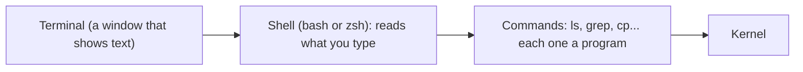

# Start here: Linux, distributions and the terminal

**Linux** is a kernel, the part of the operating system you met in the Operating Systems course. A **distribution** (distro) packages that kernel with tools, a package manager and defaults.

| Family | Popular members | Package tool | Where you meet it |
|---|---|---|---|
| Debian | Debian, Ubuntu, Linux Mint | `apt` | Laptops, most cloud servers, WSL's default |
| Red Hat | RHEL, Fedora, Rocky, AlmaLinux, Amazon Linux | `dnf` (older: `yum`) | Companies, AWS |
| SUSE | openSUSE, SLES | `zypper` | Enterprise in Europe |
| Others | Arch, Alpine (tiny, used in containers) | `pacman`, `apk` | Hobbyists, Docker images |

Learn one well and the others are 90% the same. This course uses Ubuntu/Debian commands and notes where Red Hat differs.

## Terminal, shell, command



- The **terminal** draws text and sends your keystrokes.
- The **shell** reads a line, works out what you mean, and starts programs. Most Linux servers use **bash**; macOS uses **zsh**. They're almost the same for everyday use.
- A **command** is usually just a program file somewhere like `/usr/bin/ls`.

## Get a Linux terminal

Any of these works for the whole course:

- Windows: **WSL** (`wsl --install` in PowerShell, then open Ubuntu).
- macOS: the Terminal app is Unix-like and fine for most lessons; use a Linux VM (UTM, Multipass) for the Linux-only bits.
- A free cloud VM, a Raspberry Pi, or a VirtualBox VM with Ubuntu.

## Your first commands

```bash
whoami          # your user name
hostname        # the machine's name
date
uname -a        # kernel version and architecture
cat /etc/os-release   # which distribution
echo "hello"    # print text
clear           # clear the screen (or Ctrl+L)
```

## Habits that save you

- **Tab** completes commands and file names. Press it twice to see choices. Use it constantly.
- **Up arrow** brings back earlier commands; **Ctrl+R** searches your history.
- **Ctrl+C** stops the running command. **Ctrl+D** ends input (and closes the shell if the line is empty).
- Linux is **case-sensitive**: `Notes.txt` and `notes.txt` are different files.
- Silence means success. Most commands print nothing when they work.

## Optional videos

The lesson above is complete on its own. These go deeper, if you like learning by watching.

**freeCodeCamp Introduction to Linux (Beau Carnes): Linux families and philosophy**

https://www.youtube.com/watch?v=sWbUDq4S6Y8&t=98&end=997

**MIT Missing Semester, Lecture 1: Course overview and the shell**

https://www.youtube.com/watch?v=Z56Jmr9Z34Q
