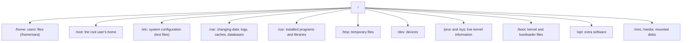

# The file system tree and paths

Linux has **one tree** starting at `/` (the root). Disks, USB sticks and network shares are attached somewhere inside it. There are no drive letters.



You'll spend most time in `/home`, `/etc` and `/var/log`.

## Where am I, what's here, go there

```bash
pwd                 # print working directory: where am I?
ls                  # list this directory
ls -l               # long format: permissions, owner, size, date
ls -la              # include hidden files (names starting with .)
ls -lh /var/log     # human-readable sizes, another directory
cd /etc             # change directory
cd                  # go home
cd -                # go back to where you were
```

## Absolute and relative paths

| Path | Starts from | Example |
|---|---|---|
| **Absolute** | `/`, the root | `/home/sara/notes/todo.txt` |
| **Relative** | Where you are now | `notes/todo.txt` (if you're in `/home/sara`) |

Special names:

- `.` this directory
- `..` the parent directory (`cd ..` goes up one)
- `~` your home directory (`~/notes` is `/home/sara/notes` for sara)

## Reading `ls -l`

```text
-rw-r--r-- 1 sara staff  2048 Nov 17 09:12 todo.txt
drwxr-xr-x 3 sara staff  4096 Nov 16 18:40 photos
│└─┬──────┘   │    │      │                 └ name
│  permissions owner group size
└ type: - file, d directory, l link
```

Permissions get their own day (Day 7).

## Try it

```bash
cd /
ls
cd /var/log && ls -lh | head
cd ~ && pwd
ls -la ~           # find your hidden config files, like .bashrc
```

## Optional videos

The lesson above is complete on its own. These go deeper, if you like learning by watching.

**freeCodeCamp Introduction to Linux: Linux basics and system startup**

https://www.youtube.com/watch?v=sWbUDq4S6Y8&t=997&end=3936
