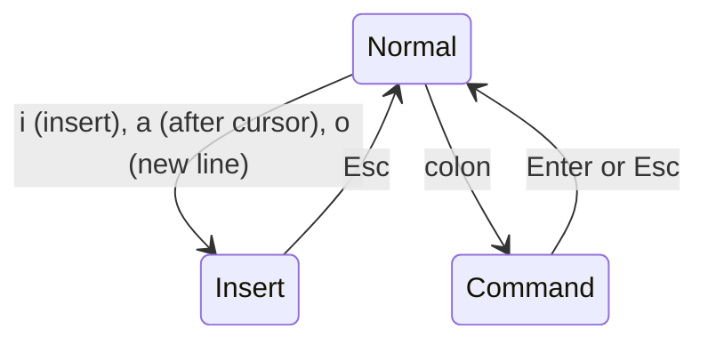

# Editing files: nano and enough vim

On a server there's no mouse and often no graphical editor. You need at least one terminal editor.

## nano: the easy one

```bash
nano notes.txt
```

The shortcuts are listed at the bottom (`^` means Ctrl):

- Ctrl+O save ("write Out"), Enter to confirm the name
- Ctrl+X exit
- Ctrl+W search, Ctrl+K cut a line, Ctrl+U paste

## vim: the one that's always there

`vi`/`vim` is installed on almost every Unix machine, including tiny containers and rescue shells. Even if you prefer nano, learn enough vim not to get stuck.

vim has **modes**:



| You want to | In Normal mode type |
|---|---|
| Start typing | `i` |
| Stop typing | `Esc` |
| Save | `:w` Enter |
| Quit | `:q` Enter |
| Save and quit | `:wq` (or `ZZ`) |
| Quit without saving | `:q!` |
| Delete a line | `dd` |
| Undo / redo | `u` / Ctrl+R |
| Search | `/word` then `n` |
| Go to line 42 | `:42` |
| Copy line, paste | `yy`, `p` |

That table is enough to edit any config file. `vimtutor` (just type it) is a 30-minute interactive lesson if you want more.

## Edit system files safely

```bash
sudo cp /etc/hosts /etc/hosts.bak   # back up first
sudo nano /etc/hosts                # or: sudoedit /etc/hosts
```

`sudoedit` opens a copy with your normal editor and writes it back as root, which is safer than running the whole editor as root. Set your editor once: `export EDITOR=nano` (or vim) in `~/.bashrc`.

## Optional videos

The lesson above is complete on its own. These go deeper, if you like learning by watching.

**MIT Missing Semester, Lecture 3: Editors (vim)**

https://www.youtube.com/watch?v=a6Q8Na575qc

**freeCodeCamp Introduction to Linux: text editors**

https://www.youtube.com/watch?v=sWbUDq4S6Y8&t=16271&end=17365
