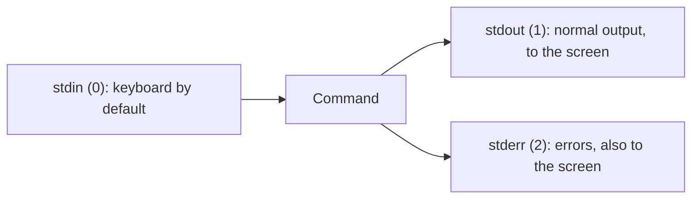

# Streams, redirection and pipes

Every process starts with three open streams (you met these as file descriptors 0, 1 and 2):



## Redirection

| Write | Meaning |
|---|---|
| `cmd > file` | stdout to a file (replaces it) |
| `cmd >> file` | stdout appended to a file |
| `cmd 2> errors.txt` | stderr to a file |
| `cmd > all.txt 2>&1` | both into one file (order matters: `>` first, then `2>&1`) |
| `cmd &> all.txt` | the same, bash shorthand |
| `cmd < input.txt` | stdin from a file |
| `cmd > /dev/null` | throw output away |

```bash
ls /etc /nope > out.txt 2> err.txt
cat out.txt err.txt
```

## Pipes

`a | b` sends a's stdout into b's stdin. Both run at the same time; the kernel's pipe buffer sits between them (the bounded buffer from the OS course).

```bash
ls -l /etc | less
cat /etc/passwd | wc -l
history | grep ssh
ps aux | sort -k4 -nr | head -5      # top 5 processes by memory
```

Small tools, each doing one thing, joined with pipes: that's the Unix philosophy, and the reason a terminal can beat a GUI for many jobs.

## tee and xargs

- `tee` copies its input to a file **and** passes it on: `make 2>&1 | tee build.log`.
- `xargs` turns input lines into **arguments**: `find . -name "*.tmp" | xargs rm` (safer with spaces: `find . -name "*.tmp" -print0 | xargs -0 rm`).

## Command substitution

`$(command)` puts a command's output into another command:

```bash
echo "Today is $(date +%A)"
mkdir "backup-$(date +%F)"      # backup-2026-11-17
```

## Optional videos

The lesson above is complete on its own. These go deeper, if you like learning by watching.

**MIT Missing Semester, Lecture 1: the shell, streams and pipes**

https://www.youtube.com/watch?v=Z56Jmr9Z34Q

**freeCodeCamp Introduction to Linux: command line operations**

https://www.youtube.com/watch?v=sWbUDq4S6Y8&t=7977&end=12350
