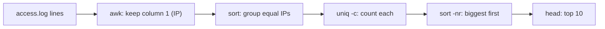

# Text processing: sort, uniq, cut, sed and awk

Logs, CSVs and command output are all just lines of text. A handful of tools turn them into answers.

| Tool | Does | Example |
|---|---|---|
| `sort` | Sort lines | `sort -n` numbers, `-r` reverse, `-k2` by column 2, `-t,` comma-separated |
| `uniq` | Merge repeated **adjacent** lines | `sort | uniq -c` counts each distinct line |
| `cut` | Take columns | `cut -d: -f1 /etc/passwd` user names |
| `tr` | Translate characters | `tr 'a-z' 'A-Z'`, `tr -d '\r'` |
| `sed` | Edit a stream | `sed 's/old/new/g'` replace |
| `awk` | A tiny language for columns | `awk '{print $1}'` first column |

## sed: find and replace

```bash
sed 's/http:/https:/g' links.txt          # print with replacements
sed -i.bak 's/8080/9090/' app.conf        # edit the file in place, keep app.conf.bak
sed -n '10,20p' big.log                   # print only lines 10 to 20
sed '/^#/d' config                        # delete comment lines
```

## awk: columns and simple maths

awk splits each line into fields `$1`, `$2`, ... (by spaces, or `-F,` for commas).

```bash
awk '{print $1, $3}' file                 # columns 1 and 3
awk -F: '$3 >= 1000 {print $1}' /etc/passwd   # normal users (UID 1000 and up)
awk '{sum += $5} END {print sum}' sizes.txt    # add up column 5
df -h | awk 'NR > 1 {print $5, $6}'       # use %, mount point (skip the header)
```

## The classic pipeline

"Which IP addresses hit my web server most?"

```bash
awk '{print $1}' access.log | sort | uniq -c | sort -nr | head -10
```



Read pipelines one stage at a time: run the first part, look, add the next. That's how everyone builds them.

## Optional videos

The lesson above is complete on its own. These go deeper, if you like learning by watching.

**MIT Missing Semester, Lecture 4: Data wrangling**

https://www.youtube.com/watch?v=sz_dsktIjt4

**freeCodeCamp Introduction to Linux: manipulating text**

https://www.youtube.com/watch?v=sWbUDq4S6Y8&t=18812&end=20404
