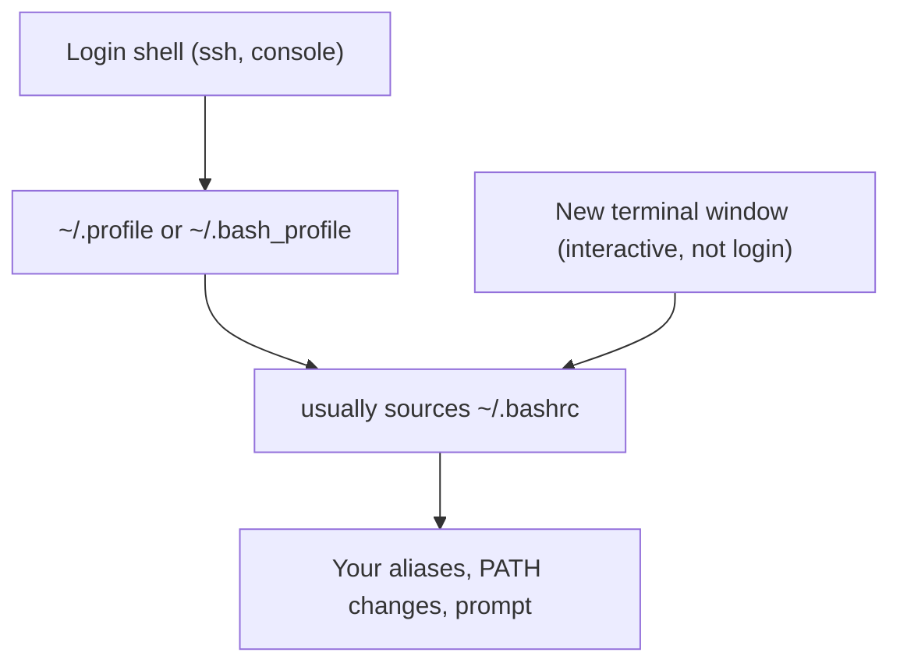

# The shell environment: variables, PATH and .bashrc

## Variables

```bash
name="Sara"            # no spaces around =
echo "Hi $name"
echo "Hi ${name}!"     # braces when text follows directly
```

A normal variable belongs to this shell only. **Export** it to pass it to programs you start:

```bash
export APP_ENV=production
python3 -c 'import os; print(os.environ["APP_ENV"])'
APP_ENV=test ./run.sh        # set it for one command only
env | sort | head            # all exported variables
```

## Variables that matter

| Variable | Holds |
|---|---|
| `HOME` | Your home directory |
| `USER` | Your user name |
| `PATH` | Where the shell looks for commands |
| `PWD` | Current directory |
| `SHELL` | Your login shell |
| `EDITOR` | Editor programs open for you (git, crontab) |
| `LANG` | Language and character set |

## PATH

When you type `python3`, the shell checks each directory in `PATH`, left to right, and runs the first match.

```bash
echo $PATH                 # /usr/local/bin:/usr/bin:/bin:...
which -a python3           # every match, in order
export PATH="$HOME/bin:$PATH"   # add your own directory in front
```

"command not found" usually means the program isn't installed, or its directory isn't in `PATH`. A script in the current directory needs `./script.sh`, because `.` is (sensibly) not in `PATH`.

## Making it permanent: startup files



Put your settings in `~/.bashrc`:

```bash
alias ll='ls -lah'
alias gs='git status'
export EDITOR=nano
export PATH="$HOME/bin:$PATH"
```

Then reload it in the current shell: `source ~/.bashrc`. System-wide versions live in `/etc/profile` and `/etc/bash.bashrc`.

## Optional videos

The lesson above is complete on its own. These go deeper, if you like learning by watching.

**freeCodeCamp Introduction to Linux: user environment**

https://www.youtube.com/watch?v=sWbUDq4S6Y8&t=17365&end=18812
