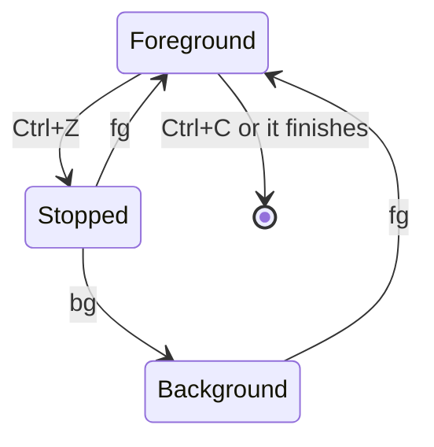

# Processes and jobs from the shell

## Seeing processes

```bash
ps                     # processes in this terminal
ps aux                 # everything, BSD style
ps -ef                 # everything, System V style
ps aux --sort=-%cpu | head    # biggest CPU users
pgrep -a nginx         # find processes by name
top                    # live view; q to quit, P sort by CPU, M by memory
htop                   # nicer top (install it)
```

`ps aux` columns: USER, PID, %CPU, %MEM, VSZ (virtual size), RSS (real memory), STAT (state), START, TIME, COMMAND. In STAT: `R` running, `S` sleeping, `D` waiting on disk (can't be interrupted), `Z` zombie, `T` stopped.

## Foreground, background and jobs

```bash
sleep 300            # runs in the foreground; the shell waits
# Ctrl+Z             # pause it (stopped)
bg                   # let it continue in the background
jobs                 # list this shell's jobs
fg %1                # bring job 1 back to the foreground
sleep 300 &          # start straight in the background
```



Background jobs die when you close the terminal. To keep something running after you log out use `nohup cmd &`, a `tmux` session (best for interactive work), or a proper service (System Administration course).

## Signals and kill

`kill` sends a **signal** to a process:

| Signal | Number | Means | Sent by |
|---|---|---|---|
| SIGINT | 2 | Interrupt, please stop | Ctrl+C |
| SIGTERM | 15 | Please shut down cleanly | `kill PID` (the default) |
| SIGKILL | 9 | Die now; can't be caught or cleaned up | `kill -9 PID` |
| SIGHUP | 1 | Terminal closed; daemons often reload config | `kill -HUP PID` |
| SIGSTOP / SIGCONT | 19 / 18 | Pause / continue | Ctrl+Z, `fg`/`bg` |

```bash
kill 1234            # polite
kill -9 1234         # only if polite didn't work after a few seconds
pkill -f "python3 server.py"
killall firefox
```

Always try `SIGTERM` first: it lets the program save files and close connections. `kill -9` can leave half-written files and stale lock files.

## Optional videos

The lesson above is complete on its own. These go deeper, if you like learning by watching.

**freeCodeCamp Introduction to Linux: processes**

https://www.youtube.com/watch?v=sWbUDq4S6Y8&t=13013&end=14871
