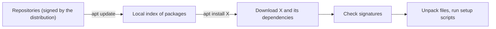

# Installing software with package managers

On Linux you rarely download installers from websites. A **package manager** installs software from your distribution's trusted **repositories**, with its dependencies, and updates everything in one go.

| Task | Debian / Ubuntu | Red Hat / Fedora |
|---|---|---|
| Refresh the list of packages | `sudo apt update` | (automatic) |
| Install | `sudo apt install htop` | `sudo dnf install htop` |
| Remove | `sudo apt remove htop` | `sudo dnf remove htop` |
| Upgrade everything | `sudo apt upgrade` | `sudo dnf upgrade` |
| Search | `apt search json` | `dnf search json` |
| Info | `apt show nginx` | `dnf info nginx` |
| Which package owns a file | `dpkg -S /usr/bin/ls` | `rpm -qf /usr/bin/ls` |
| List installed | `apt list --installed` | `dnf list installed` |



## Why repositories beat random downloads

- Packages are **signed**, so you know they came from your distribution.
- Dependencies are resolved for you.
- Security fixes arrive with `apt upgrade`.

## Other ways software arrives

| Way | Example | Note |
|---|---|---|
| Third-party repository | Docker's or PostgreSQL's own apt repo | Add its signing key and source, then `apt install` |
| `.deb` / `.rpm` file | `sudo apt install ./app.deb` | One-off; no automatic updates unless it adds a repo |
| Snap / Flatpak | `snap install code` | Self-contained, works across distros, bigger |
| Language tools | `pip`, `npm`, `cargo` | For libraries; use virtual environments, not `sudo pip` |
| From source | `./configure && make && sudo make install` | Last resort |

## Keep a server updated

```bash
sudo apt update && sudo apt upgrade
apt list --upgradable
cat /var/run/reboot-required 2>/dev/null   # Ubuntu tells you when a reboot is needed (new kernel)
```
