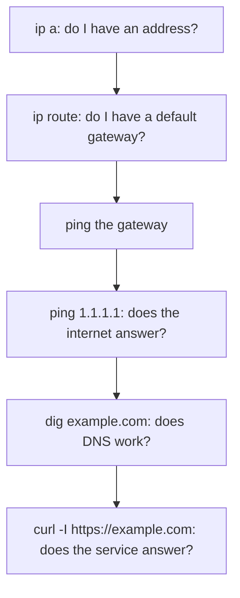

# First network commands

You'll go deep in the Networking courses. These are the commands you need from day one.

| Question | Command |
|---|---|
| What's my IP address? | `ip a` (or `ip -br a` for a short list) |
| Which way does traffic leave? | `ip route` (the `default via` line is your gateway) |
| Is that host reachable? | `ping -c 4 example.com` |
| What IP does a name have? | `dig +short example.com` or `getent hosts example.com` |
| Which ports am I listening on? | `ss -tlnp` |
| Does this web address answer? | `curl -I https://example.com` |
| Download a file | `curl -LO URL` or `wget URL` |
| Where do packets go on the way? | `traceroute example.com` or `mtr example.com` |

## curl, the Swiss army knife

```bash
curl https://example.com                 # print the page
curl -I https://example.com              # only the response headers
curl -s https://api.github.com/repos/torvalds/linux | head
curl -o file.zip -L https://...          # follow redirects, save to a file
curl -X POST -H "Content-Type: application/json" -d '{"a":1}' https://httpbin.org/post
```

## SSH: log in to another machine

```bash
ssh sara@203.0.113.10          # log in
ssh sara@server 'df -h'        # run one command remotely
scp report.pdf sara@server:~/  # copy a file to it
scp sara@server:/var/log/syslog .   # copy a file back
```

Better than passwords: a key pair.

```bash
ssh-keygen -t ed25519          # creates ~/.ssh/id_ed25519 (private) and .pub (public)
ssh-copy-id sara@server        # puts your public key on the server
```

The private key never leaves your machine and must be `chmod 600`. The SSH course covers config files, jump hosts and hardening.

## A quick health check of a connection problem



Work down the list; the first step that fails tells you where the problem is.

## Optional videos

The lesson above is complete on its own. These go deeper, if you like learning by watching.

**freeCodeCamp Introduction to Linux: network operations**

https://www.youtube.com/watch?v=sWbUDq4S6Y8&t=20404&end=22052
