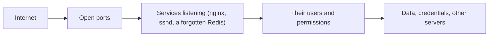

# Start here: threat models and attack surface

Security starts with three questions (MIT 6.858's opening lecture):

| Question | For a web server, for example |
|---|---|
| **Policy**: what must be true? | Only admins can change the site; customer data stays private |
| **Threat model**: who are we defending against, and what can they do? | Internet bots, password guessers, a stolen laptop, a malicious package |
| **Mechanism**: what enforces the policy? | Firewall, SSH keys, permissions, TLS, updates, backups |

Most real break-ins exploit a **wrong assumption in the threat model**, not a broken mechanism: "nobody will scan this port", "this internal service is never exposed", "this admin never reuses passwords".

## Attack surface

Everything an attacker can reach: open ports, running services, user accounts, web forms, installed packages, SUID programs, cloud credentials on the box. **Reduce it first.** A service that isn't running can't be hacked.

## Principles that hold everywhere

- **Least privilege**: every user, service and key gets only what it needs.
- **Defence in depth**: several layers, so one mistake isn't fatal (firewall + auth + permissions + monitoring).
- **Fail closed**: when unsure, deny.
- **Secure defaults**: the easiest configuration should be the safe one.
- **Assume breach**: plan detection and recovery, not just prevention.

## How this course works

Linux Networking & Security puts the Networking Fundamentals course to work on servers: interfaces and routes, nftables firewalls and NAT, SSH and TLS, permissions, logs and detection, and a hardening checklist. Optional videos come from **MIT 6.858 Computer Systems Security** (Nickolai Zeldovich) and MIT's Missing Semester. Use VMs: you'll break things on purpose.

## Optional videos

The lesson above is complete on its own. These go deeper, if you like learning by watching.

**MIT 6.858, Lecture 1: Introduction and threat models**

https://www.youtube.com/watch?v=GqmQg-cszw4

**MIT Missing Semester, Lecture 9: Security and cryptography**

https://www.youtube.com/watch?v=tjwobAmnKTo
