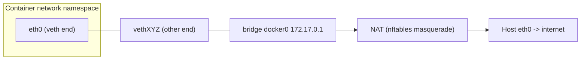

# Linux network configuration in depth

The `ip` command (package iproute2) controls the kernel's network stack directly. Netplan and NetworkManager (System Administration course) make changes permanent; `ip` is how you inspect and experiment.

```bash
ip -br link                          # interfaces and state
ip -br addr
ip addr add 10.0.50.5/24 dev eth1    # add an address (temporary)
ip link set eth1 up
ip route add 10.8.0.0/16 via 10.0.50.1   # a static route (temporary)
ip -s link show eth0                 # counters: errors and drops
```

## Virtual interfaces you'll meet

| Type | What it is | Where |
|---|---|---|
| **lo** | Loopback | Every machine |
| **bridge** | A software switch | Docker (`docker0`), VMs |
| **veth pair** | A virtual cable with two ends | Connects a container's namespace to a bridge |
| **bond / team** | Several NICs as one, for redundancy or speed | Physical servers |
| **VLAN** (`eth0.20`) | A tagged VLAN on one NIC | Data centres |
| **tun / wg0** | VPN tunnels | OpenVPN, WireGuard |



Build one by hand (needs root):

```bash
sudo ip netns add lab
sudo ip link add veth-host type veth peer name veth-lab
sudo ip link set veth-lab netns lab
sudo ip addr add 10.99.0.1/24 dev veth-host && sudo ip link set veth-host up
sudo ip netns exec lab ip addr add 10.99.0.2/24 dev veth-lab
sudo ip netns exec lab ip link set veth-lab up
sudo ip netns exec lab ping -c2 10.99.0.1     # it works: you just built container networking
sudo ip netns del lab
```

## Forwarding and multiple interfaces

A Linux box becomes a router with one setting: `sysctl net.ipv4.ip_forward=1`. Servers with two interfaces (public and private) need care: replies must leave by the right interface, or they get dropped (`rp_filter`) or look like spoofing. `ip rule` and extra routing tables solve this ("policy routing").
