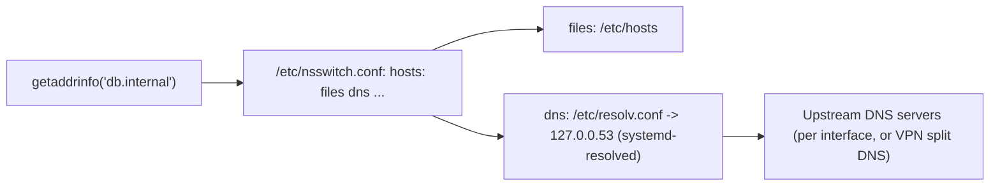

# Name resolution and network troubleshooting on Linux

## How Linux resolves a name



```bash
getent hosts db.internal        # resolve exactly like programs do
resolvectl status               # upstream servers per interface
resolvectl query example.com    # through systemd-resolved, with timing
resolvectl flush-caches
dig example.com                 # straight DNS, bypassing /etc/hosts and nsswitch
```

`dig` working but your app failing usually means the problem is in `/etc/hosts`, nsswitch, or a search domain, which `dig` skips. Test with `getent`.

## A troubleshooting toolkit

| Question | Command |
|---|---|
| Is the interface up, any errors? | `ip -s link` |
| Which route and source address will be used? | `ip route get 10.0.0.5` |
| Is the neighbour (gateway) resolved? | `ip neigh` (FAILED / INCOMPLETE = layer 2 problem) |
| Is the service listening, on which address? | `ss -tlnp` |
| Can I open the port? | `nc -zv host port` |
| Is the firewall dropping it? | `sudo nft list ruleset`, counters (next day) |
| What actually crosses the wire? | `tcpdump -n -i any host X` |
| Which process makes those connections? | `ss -tnp`, `lsof -i` |

## The four questions for "service unreachable"

1. Is it running? (`systemctl status`)
2. Is it listening on the right address and port? (`ss -tlnp`)
3. Is a firewall in the way, on the host or in the cloud? (`nft list ruleset`, security groups)
4. Does the path exist both ways? (`ip route`, `tcpdump` on both ends)

## Optional videos

The lesson above is complete on its own. These go deeper, if you like learning by watching.

**MIT 6.858, Lecture 13: Network protocols (DNS and more)**

https://www.youtube.com/watch?v=QOtA76ga_fY
