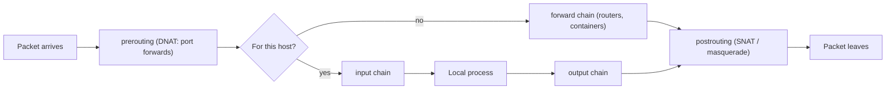

# Firewalls with nftables

**Netfilter** is the packet-filtering engine in the kernel. **nftables** (`nft`) is its modern interface; `ufw` and `firewalld` write nftables rules for you, and old `iptables` commands are translated into it on current distributions.

## Where rules hook in



## A complete server firewall

`/etc/nftables.conf`:

```text
#!/usr/sbin/nft -f
flush ruleset

table inet filter {                       # inet = IPv4 and IPv6 together
  chain input {
    type filter hook input priority 0; policy drop;   # deny by default

    ct state established,related accept   # replies to our own connections
    ct state invalid drop
    iif "lo" accept                         # loopback
    ip protocol icmp accept                 # ping, and "too big" messages (MTU!)
    ip6 nexthdr icmpv6 accept               # IPv6 needs ICMPv6 to work at all

    tcp dport 22 ip saddr 203.0.113.0/24 accept    # SSH only from the office
    tcp dport { 80, 443 } accept
    tcp dport 5432 ip saddr 10.0.10.0/24 accept    # Postgres from the app subnet

    limit rate 5/minute log prefix "nft-drop: "    # log a sample of drops
  }
  chain forward { type filter hook forward priority 0; policy drop; }
  chain output  { type filter hook output priority 0; policy accept; }
}
```

```bash
sudo nft -c -f /etc/nftables.conf      # check syntax
sudo nft -f /etc/nftables.conf         # load
sudo systemctl enable nftables         # load at boot
sudo nft list ruleset
sudo nft list ruleset -a               # with handles, to delete one rule
```

## Stateful filtering

`ct state established,related accept` is the heart of it: once your server accepts a connection or opens one itself, the replies flow back automatically. You only write rules for **new** connections.

## Don't lock yourself out

Load a new ruleset with a safety net: `sudo nft -f new.conf; sleep 60; sudo nft -f old.conf` in a `tmux` session, and cancel the sleep once you've confirmed SSH still works. (`netplan try` has the same idea for networking.)

## Optional videos

The lesson above is complete on its own. These go deeper, if you like learning by watching.

**MIT 6.858, Lecture 12: Network security**

https://www.youtube.com/watch?v=BZTWXl9QNK8
