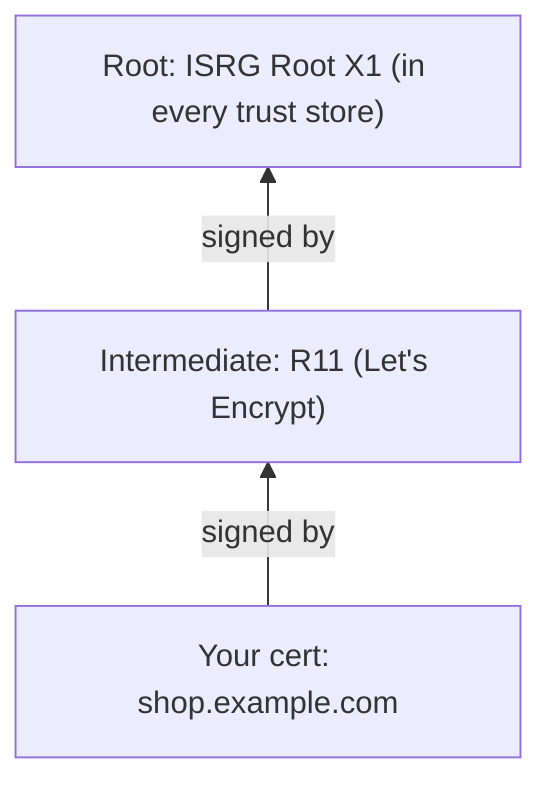

# TLS certificates on your servers

## The pieces

| Piece | What it is | Who sees it |
|---|---|---|
| **Private key** | The secret. Proves you own the certificate | Only the server. Mode 600 |
| **Certificate** | Your public key + name(s) + validity, signed by a CA | Everyone |
| **Intermediate certificate(s)** | Link your certificate to a root the clients trust | Sent with yours (the "chain") |
| **Root CA** | Pre-installed in browsers and OS trust stores | Clients |



## Let's Encrypt with certbot

```bash
sudo apt install certbot python3-certbot-nginx
sudo certbot --nginx -d shop.example.com -d www.shop.example.com
systemctl list-timers | grep certbot      # renewal runs twice a day
sudo certbot renew --dry-run
```

Certificates last 90 days (moving to shorter), so **automatic renewal is not optional**. For servers not on the internet, use the DNS challenge (`--preferred-challenges dns`) or an internal CA.

## A modern nginx TLS setup

```nginx
server {
    listen 443 ssl;
    http2 on;
    server_name shop.example.com;
    ssl_certificate     /etc/letsencrypt/live/shop.example.com/fullchain.pem;   # cert + intermediates
    ssl_certificate_key /etc/letsencrypt/live/shop.example.com/privkey.pem;
    ssl_protocols TLSv1.2 TLSv1.3;
    add_header Strict-Transport-Security "max-age=31536000; includeSubDomains" always;
}
server {
    listen 80;
    server_name shop.example.com;
    return 301 https://$host$request_uri;      # redirect all plain HTTP
}
```

- Use `fullchain.pem`, not `cert.pem`: a missing intermediate works in your browser (which may have it cached) and breaks for everyone else.
- **HSTS** tells browsers to use HTTPS only for a year, stopping downgrade attacks. Turn it on only once HTTPS works everywhere on the domain.
- Check your setup with SSL Labs' free test (ssllabs.com/ssltest).

## Optional videos

The lesson above is complete on its own. These go deeper, if you like learning by watching.

**MIT 6.858, Lecture 14: SSL and HTTPS**

https://www.youtube.com/watch?v=q1OF_0ICt9A
