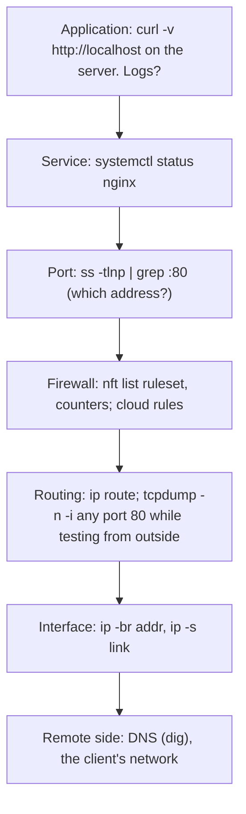

# Capstone: the lab where HTTP stopped working

> A server is reachable by SSH, but HTTP suddenly stopped working. Diagnose it.

Set it up on a VM with nginx serving a page. Ask a friend (or write a script) to break **one** of these at random, then find it using only the symptom:

1. nginx stopped (`systemctl stop nginx`).
2. nginx listening on `127.0.0.1:80` only.
3. nftables input rule for 80 removed.
4. A cloud security group (or a second firewall layer) dropping 80.
5. A wrong default route on the server, so replies go nowhere (SSH still works from the same subnet).
6. An expired or wrong TLS certificate (for HTTPS).
7. DNS for the site name pointing to an old IP.

## Work down the stack

## The checks that tell you which one

| Check | If it fails, it's |
|---|---|
| `curl -s localhost` on the server | 1 (or the app itself) |
| `ss -tlnp` shows `127.0.0.1:80` | 2 |
| `tcpdump` on the server sees SYNs but nothing answers, and nft counters climb on drop | 3 |
| `tcpdump` on the server sees **nothing** when you test from outside | 4 (blocked before it arrives) or 7 (wrong IP) |
| SYNs arrive, SYN-ACKs leave, the client never sees them | 5 |
| `curl -v https://` shows a certificate error | 6 |
| `dig +short site` doesn't match the server's IP | 7 |

## Then harden it

Finish by applying the whole checklist to this server, run `lynis` before and after, and write a one-page runbook: what the server does, its firewall rules and why, how to renew its certificate, and how to recover from each of the seven failures.
