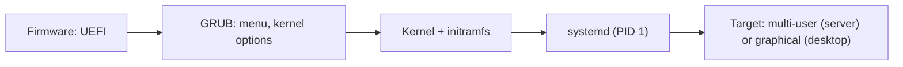

# Start here: from user to administrator, and the boot process

In Linux Fundamentals you learned to **use** a machine. Now you'll **run** one: keep it up, keep it safe, fix it when it breaks. Every lesson ends with the questions an administrator asks: *how do I check it, how do I change it, how do I know it worked?*

You need a machine you can break: a VM (VirtualBox, UTM, Multipass) or a cheap cloud server running **Ubuntu Server 24.04** or **Rocky/Alma Linux 9**. Take a snapshot before risky labs.

## The boot process, as an administrator sees it



| Stage | Files and commands |
|---|---|
| GRUB | `/etc/default/grub`, then `sudo update-grub` (Ubuntu) or `sudo grub2-mkconfig -o /boot/grub2/grub.cfg` (Red Hat) |
| Kernel and initramfs | `/boot/vmlinuz-*`, `/boot/initrd.img-*`; rebuild with `update-initramfs -u` or `dracut -f` |
| Kernel options in use | `cat /proc/cmdline` |
| systemd target | `systemctl get-default`, `sudo systemctl set-default multi-user.target` |

## Targets (the old runlevels)

| Target | Old runlevel | Means |
|---|---|---|
| `multi-user.target` | 3 | Normal server: networking, no desktop |
| `graphical.target` | 5 | Desktop login |
| `rescue.target` | 1 | Single user, minimal services, for repairs |
| `emergency.target` | | Even less: root file system read-only |

## Getting in when boot fails

1. At the GRUB menu press `e` on the entry.
2. On the line starting with `linux`, add `systemd.unit=rescue.target` (or `emergency.target`).
3. Ctrl+X to boot. You get a root shell to fix `/etc/fstab`, a bad config, or a forgotten password.

## Kernel panics

If the kernel itself can't continue (no root file system, a broken driver), it **panics** and stops. Usual causes: a wrong `root=` option, a missing initramfs after a kernel update, or bad hardware. Boot the previous kernel from GRUB's "Advanced options", then fix it.

```bash
uname -r                       # running kernel
ls /boot                       # installed kernels
journalctl -b -1 -p err        # errors from the previous boot
systemd-analyze critical-chain # what slowed this boot
```

## Optional videos

The lesson above is complete on its own. These go deeper, if you like learning by watching.

**Shawn Powers, Linux Server Course: kernel and boot concepts**

https://www.youtube.com/watch?v=WMy3OzvBWc0&t=34&end=2240
