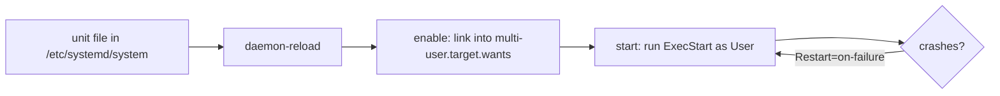

# Services with systemd

A **service** (daemon) is a program that runs in the background: a web server, a database, SSH. systemd starts them, restarts them when they crash, and records their logs.

## The commands you'll use daily

```bash
systemctl status nginx          # running? since when? last log lines
sudo systemctl start nginx
sudo systemctl stop nginx
sudo systemctl restart nginx    # stop + start
sudo systemctl reload nginx     # re-read config without dropping connections (if supported)
sudo systemctl enable nginx     # start at boot
sudo systemctl enable --now nginx   # enable and start in one go
sudo systemctl disable nginx
systemctl is-active nginx; systemctl is-enabled nginx
systemctl --failed              # anything broken?
systemctl list-units --type=service
```

**Started** (running now) and **enabled** (will start at boot) are separate. A classic mistake is starting a service, rebooting, and finding it gone because it was never enabled.

## Units

systemd manages **units**: `.service`, `.timer`, `.socket`, `.mount`, `.target`. Unit files live in:

| Place | Who writes there |
|---|---|
| `/usr/lib/systemd/system/` (or `/lib/...`) | Packages. Don't edit. |
| `/etc/systemd/system/` | You. Overrides win. |

To change a packaged service, use an override: `sudo systemctl edit nginx` opens a drop-in file just for your changes.

## Write your own service

`/etc/systemd/system/myapp.service`:

```ini
[Unit]
Description=My Python app
After=network-online.target
Wants=network-online.target

[Service]
User=myapp
WorkingDirectory=/opt/myapp
ExecStart=/opt/myapp/venv/bin/python app.py
Restart=on-failure
RestartSec=5
Environment=APP_ENV=production

[Install]
WantedBy=multi-user.target
```

```bash
sudo systemctl daemon-reload        # after any unit file change
sudo systemctl enable --now myapp
systemctl status myapp
```



Running as a dedicated user (not root), with `Restart=on-failure`, is the minimum for anything in production. systemd also has strong sandbox options (`ProtectSystem=strict`, `PrivateTmp=yes`, `NoNewPrivileges=yes`); the security course uses them.

## Optional videos

The lesson above is complete on its own. These go deeper, if you like learning by watching.

**Shawn Powers, Linux Server Course: managing local services**

https://www.youtube.com/watch?v=WMy3OzvBWc0&t=13880&end=15400
