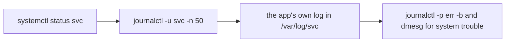

# Logs: journalctl, syslog and logrotate

When something breaks, logs are where you look first.

## The systemd journal

```bash
journalctl -u nginx                  # one service
journalctl -u nginx -f               # follow live
journalctl -u nginx --since "1 hour ago"
journalctl -b                        # this boot
journalctl -b -1                     # previous boot
journalctl -p err -b                 # errors and worse, this boot
journalctl -k                        # kernel messages
journalctl --disk-usage
sudo journalctl --vacuum-time=14d    # delete entries older than 14 days
```

Priorities, most to least severe: `emerg`, `alert`, `crit`, `err`, `warning`, `notice`, `info`, `debug`.

By default on some systems the journal is kept only in memory and lost at reboot. To keep it, create `/var/log/journal` (or set `Storage=persistent` in `/etc/systemd/journald.conf`) and restart `systemd-journald`.

## Classic text logs

Many distributions also run **rsyslog**, which writes text files in `/var/log`:

| File (Ubuntu) | File (Red Hat) | Holds |
|---|---|---|
| `/var/log/syslog` | `/var/log/messages` | General system messages |
| `/var/log/auth.log` | `/var/log/secure` | Logins, sudo, SSH |
| `/var/log/kern.log` | (in messages) | Kernel |
| `/var/log/nginx/`, `/var/log/apt/` | similar | Per-application |

## logrotate: stop logs filling the disk

logrotate runs daily, renames `app.log` to `app.log.1`, compresses older ones and deletes the oldest. Config: `/etc/logrotate.conf` and `/etc/logrotate.d/*`.

```text
/var/log/myapp/*.log {
    daily
    rotate 14
    compress
    missingok
    notifempty
    copytruncate
}
```

Test without changing anything: `sudo logrotate -d /etc/logrotate.d/myapp`.

## A troubleshooting habit



Read the **first** error, not the last. Later errors are often just consequences.
