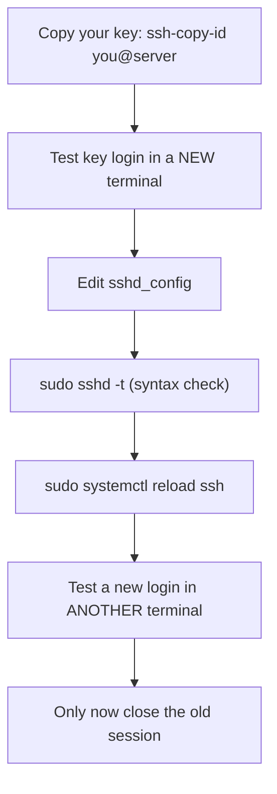

# Running the SSH server safely

Almost every Linux server is managed over SSH, so `sshd` is both your lifeline and the first thing attackers try.

```bash
sudo apt install openssh-server        # Ubuntu (Red Hat: openssh-server, usually installed)
systemctl status ssh                   # 'sshd' on Red Hat
sudo ss -tlnp | grep :22
```

## The settings that matter

In `/etc/ssh/sshd_config` (or a file in `/etc/ssh/sshd_config.d/`):

```text
PermitRootLogin no            # log in as yourself, then sudo
PasswordAuthentication no     # keys only (set up and TEST your key first!)
PubkeyAuthentication yes
AllowUsers sara deploy        # only these accounts may log in
MaxAuthTries 3
```

## Change it without locking yourself out



Keep your current session open until a fresh login works. On cloud servers, also know where the provider's web console is, in case you get it wrong.

## Watch who's knocking

```bash
sudo journalctl -u ssh --since today | grep -i "failed\|invalid" | tail
last -n 10; lastb -n 10 2>/dev/null     # good and failed logins
```

An internet-facing server sees password guesses within minutes of going online. With passwords off they can't succeed, but **fail2ban** (bans IPs after repeated failures) reduces the noise: `sudo apt install fail2ban`, enable the `sshd` jail.

The SSH course goes much further: `~/.ssh/config`, agents, jump hosts and tunnels.
