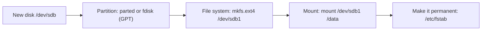

# Disks, partitions, file systems and fstab

## The steps to use a new disk



```bash
lsblk                                   # find the new disk (no partitions, no mount point)
sudo parted /dev/sdb --script mklabel gpt mkpart data ext4 0% 100%
sudo mkfs.ext4 -L data /dev/sdb1        # or mkfs.xfs (Red Hat's default)
sudo mkdir /data
sudo mount /dev/sdb1 /data
df -h /data
```

**Double-check the device name.** `mkfs` on the wrong disk destroys it instantly. `lsblk` first, every time.

## fstab: mounts at boot

Device names like `/dev/sdb` can change between boots. Use the **UUID**:

```bash
sudo blkid /dev/sdb1     # UUID="3f1c..." TYPE="ext4"
```

`/etc/fstab` line:

```text
UUID=3f1c...  /data  ext4  defaults,nofail  0  2
```

Fields: what, where, type, options, dump (0), fsck order (`1` for `/`, `2` others, `0` never).

Then test **before** rebooting, because a broken fstab can stop the machine booting:

```bash
sudo umount /data
sudo mount -a          # mounts everything in fstab; errors show now, not at boot
sudo findmnt --verify  # checks fstab for mistakes
```

`nofail` lets the machine boot even if that disk is missing.

## Space problems

```bash
df -h                      # space per file system
df -i                      # inodes: you can run out with millions of tiny files
sudo du -xh / --max-depth=1 2>/dev/null | sort -h | tail   # biggest top-level directories
sudo du -sh /var/log/* | sort -h | tail
```

## Checking and repairing

`fsck` (`e2fsck` for ext4, `xfs_repair` for XFS) only on **unmounted** file systems. For the root file system that means booting a rescue system, or `touch /forcefsck` style options at next boot depending on the distribution.

## Optional videos

The lesson above is complete on its own. These go deeper, if you like learning by watching.

**Shawn Powers, Linux Server Course: managing storage**

https://www.youtube.com/watch?v=WMy3OzvBWc0&t=4633&end=7938
