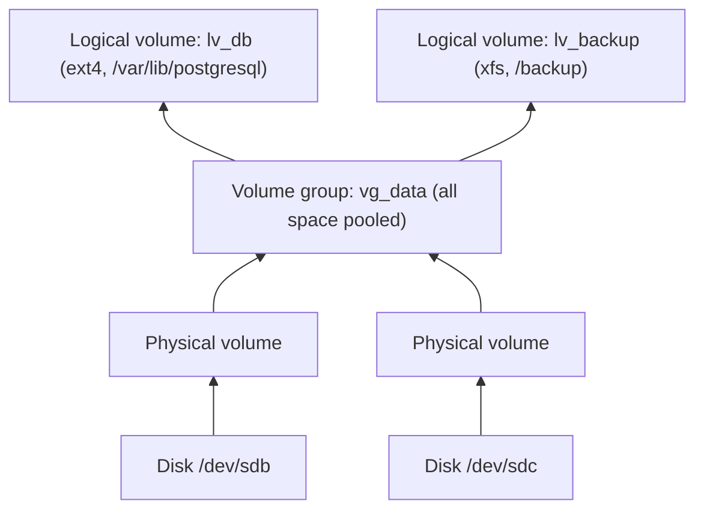

# LVM, RAID and swap

## LVM: flexible disks

LVM puts a layer between disks and file systems so you can grow volumes, add disks and take snapshots without repartitioning.



```bash
sudo pvcreate /dev/sdb /dev/sdc
sudo vgcreate vg_data /dev/sdb /dev/sdc
sudo lvcreate -n lv_db -L 50G vg_data
sudo mkfs.ext4 /dev/vg_data/lv_db
sudo pvs; sudo vgs; sudo lvs            # summaries

# Out of space later? Grow the volume AND the file system in one go:
sudo lvextend -r -L +20G /dev/vg_data/lv_db
```

`-r` resizes the file system too. Growing is safe online for ext4 and XFS. Shrinking is risky (and impossible for XFS): plan to grow, not shrink.

Ubuntu Server and Red Hat installers put the root file system on LVM by default, often leaving free space unallocated in the volume group. `sudo vgs` shows it.

## Software RAID with mdadm

```bash
sudo mdadm --create /dev/md0 --level=1 --raid-devices=2 /dev/sdb /dev/sdc
cat /proc/mdstat                         # build progress and health
sudo mdadm --detail /dev/md0
sudo mdadm --detail --scan | sudo tee -a /etc/mdadm/mdadm.conf
```

When a disk fails, `/proc/mdstat` shows `[U_]` instead of `[UU]`. Replace it with `--fail`, `--remove`, then `--add` the new disk. And remember: RAID is not a backup.

## Swap

Swap is disk space for pages that don't fit in RAM. A swap **file** is the easy way:

```bash
sudo fallocate -l 2G /swapfile
sudo chmod 600 /swapfile
sudo mkswap /swapfile
sudo swapon /swapfile
echo '/swapfile none swap sw 0 0' | sudo tee -a /etc/fstab
swapon --show; free -h
cat /proc/sys/vm/swappiness    # 0-200: how eagerly to swap (60 is a common default)
```

A little swap lets the kernel move truly idle pages out of RAM. Heavy, constant swapping means the machine needs more memory.

## Optional videos

The lesson above is complete on its own. These go deeper, if you like learning by watching.

**Shawn Powers, Linux Server Course: storage, LVM and RAID**

https://www.youtube.com/watch?v=WMy3OzvBWc0&t=4633&end=7938
