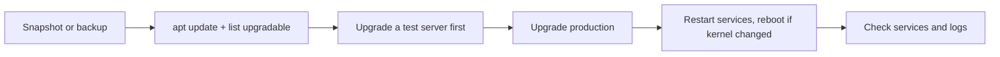

# Packages, repositories and keeping servers updated

You learned `apt install` in Linux Fundamentals. Administering means keeping **many** packages current, safely.

## Repositories

| Distribution | Where repositories are listed |
|---|---|
| Ubuntu / Debian | `/etc/apt/sources.list.d/*.sources` (newer) or `*.list` |
| Red Hat family | `/etc/yum.repos.d/*.repo` |

Adding a vendor repository (for example PostgreSQL's or Docker's) always has two parts: its **signing key**, and the **repository line** that says to trust only that key for it. Follow the vendor's instructions exactly; they're short.

```bash
apt policy nginx              # which version from which repository
dnf repolist                  # enabled repositories (Red Hat)
```

## Updating without surprises

```bash
sudo apt update
apt list --upgradable
sudo apt upgrade              # upgrade, never removes packages
sudo apt full-upgrade         # may add or remove packages to complete an upgrade
sudo apt autoremove           # remove dependencies nothing needs anymore
sudo dnf upgrade --refresh    # Red Hat family
sudo dnf history              # what changed when (and `dnf history undo N`)
```

- **Security updates automatically**: `sudo apt install unattended-upgrades` then `sudo dpkg-reconfigure unattended-upgrades` (Ubuntu). Red Hat: `dnf-automatic`.
- **Hold** a package at its version when an upgrade would break something: `sudo apt-mark hold postgresql-16` (`unhold` later); Red Hat: `dnf versionlock`.
- **Kernel updates** need a reboot to take effect. Plan them; `needrestart` tells you which services also need restarting after library updates.

## A safe update routine



## Optional videos

The lesson above is complete on its own. These go deeper, if you like learning by watching.

**Shawn Powers, Linux Server Course: installing, updating and configuring software**

https://www.youtube.com/watch?v=WMy3OzvBWc0&t=7938&end=9160
