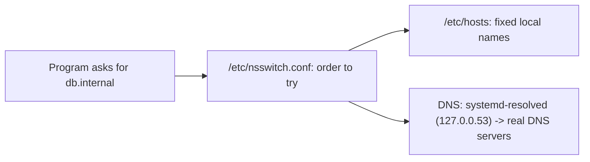

# Configuring the network: addresses, DNS and hostnames

## Who manages the network here?

| System | Tool | Config |
|---|---|---|
| Ubuntu Server | **netplan** (writes config for systemd-networkd) | `/etc/netplan/*.yaml` |
| Ubuntu Desktop, Red Hat family | **NetworkManager** | `nmcli`, files in `/etc/NetworkManager/system-connections/` |

## A static IP with netplan

```yaml
# /etc/netplan/50-static.yaml
network:
  version: 2
  ethernets:
    enp0s3:
      dhcp4: false
      addresses: [192.168.1.50/24]
      routes:
        - to: default
          via: 192.168.1.1
      nameservers:
        addresses: [1.1.1.1, 9.9.9.9]
```

```bash
sudo netplan try        # applies it and ROLLS BACK after 120 s unless you confirm. Use this, not apply, over SSH.
```

## The same with NetworkManager

```bash
nmcli connection show
sudo nmcli con mod "Wired connection 1" ipv4.method manual \
  ipv4.addresses 192.168.1.50/24 ipv4.gateway 192.168.1.1 ipv4.dns "1.1.1.1 9.9.9.9"
sudo nmcli con up "Wired connection 1"
```

## Name resolution



```bash
resolvectl status          # which DNS servers each interface uses
getent hosts db.internal   # resolves exactly the way programs do
cat /etc/hosts
```

`/etc/resolv.conf` on modern Ubuntu points at `127.0.0.53` (systemd-resolved). Don't edit it by hand there; set DNS in netplan or NetworkManager.

## Hostname

```bash
hostnamectl
sudo hostnamectl set-hostname web01
```

Also add `127.0.1.1 web01` to `/etc/hosts` so the machine can resolve its own name.

## Checking

```bash
ip -br a; ip route
ping -c 3 192.168.1.1
resolvectl query example.com
```

## Optional videos

The lesson above is complete on its own. These go deeper, if you like learning by watching.

**Shawn Powers, Linux Server Course: configuring and verifying network connections**

https://www.youtube.com/watch?v=WMy3OzvBWc0&t=2240&end=4633
