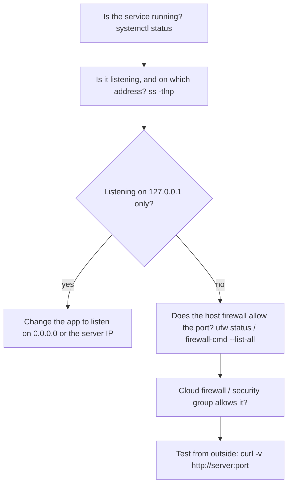

# A host firewall: ufw and firewalld

A host firewall decides which incoming connections the machine accepts. Default rule for servers: **deny incoming, allow outgoing, open only what you serve.**

Both tools below are friendly front ends to the kernel's **nftables** (the Linux Networking & Security course goes underneath).

## ufw (Ubuntu)

```bash
sudo ufw default deny incoming
sudo ufw default allow outgoing
sudo ufw allow OpenSSH            # BEFORE enabling, or you lock yourself out over SSH
sudo ufw allow 80,443/tcp
sudo ufw allow from 10.0.0.0/8 to any port 5432   # Postgres only from the private network
sudo ufw enable
sudo ufw status numbered
sudo ufw delete 3
```

## firewalld (Red Hat family)

```bash
sudo firewall-cmd --state
sudo firewall-cmd --list-all
sudo firewall-cmd --permanent --add-service=http --add-service=https
sudo firewall-cmd --permanent --add-rich-rule='rule family=ipv4 source address=10.0.0.0/8 port port=5432 protocol=tcp accept'
sudo firewall-cmd --reload
```

`--permanent` writes the rule for after reboot; without it, the rule lasts only until the next reload.

## Debugging "the service is up but I can't reach it"



The most common answer is the box in the middle: the app listens only on `127.0.0.1`, so nothing outside can reach it no matter what the firewall says.
