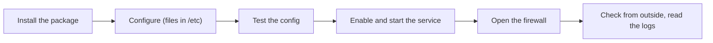

# Server roles: setting up a web server

Servers usually play one or more **roles**: web server, reverse proxy, database, file share, DNS, log collector, VPN, container host, load balancer. Setting one up always follows the same pattern.



## Example: nginx serving a site

```bash
sudo apt install nginx
sudo mkdir -p /var/www/demo
echo '<h1>It works</h1>' | sudo tee /var/www/demo/index.html
sudo chown -R www-data:www-data /var/www/demo
```

`/etc/nginx/sites-available/demo`:

```nginx
server {
    listen 80;
    server_name demo.example.com;
    root /var/www/demo;
    index index.html;
    access_log /var/log/nginx/demo.access.log;
}
```

```bash
sudo ln -s /etc/nginx/sites-available/demo /etc/nginx/sites-enabled/
sudo nginx -t                       # test the config FIRST
sudo systemctl reload nginx
sudo ufw allow 'Nginx Full'
curl -H "Host: demo.example.com" http://localhost/
```

## nginx as a reverse proxy

In real deployments nginx often sits in front of an application:

```nginx
location / {
    proxy_pass http://127.0.0.1:8000;      # your app, listening only locally
    proxy_set_header Host $host;
    proxy_set_header X-Forwarded-For $proxy_add_x_forwarded_for;
}
```

The app listens on `127.0.0.1` (unreachable from outside); nginx handles the internet, TLS, and serving static files.

## HTTPS

With a real domain pointing at the server: `sudo apt install certbot python3-certbot-nginx` then `sudo certbot --nginx -d demo.example.com`. It gets a free Let's Encrypt certificate and renews it with a timer.

## The pattern for any role

| Step | Database example (PostgreSQL) |
|---|---|
| Install | `apt install postgresql` |
| Configure | `/etc/postgresql/16/main/postgresql.conf`, `pg_hba.conf` |
| Test | `sudo -u postgres psql -c 'select 1'` |
| Run | `systemctl enable --now postgresql` |
| Firewall | Port 5432 from the app servers only |
| Logs | `/var/log/postgresql/` |

## Optional videos

The lesson above is complete on its own. These go deeper, if you like learning by watching.

**Shawn Powers, Linux Server Course: server roles**

https://www.youtube.com/watch?v=WMy3OzvBWc0&t=15400&end=17390
