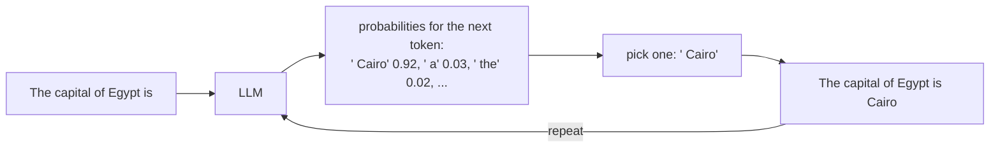

# What an LLM is: a next-token predictor

A **large language model (LLM)** is a neural network trained to do one thing: given some text, predict what comes next. Everything else (answering questions, writing code, translating, using tools) is built on that single skill.

## Generation is a loop

The model doesn't write a whole answer at once. It produces a probability for every possible next piece of text (a **token**), one is picked, it's added to the text, and the model runs again. A 300-token answer is 300 runs of the model. This explains a lot:

- Answers appear word by word (streaming) because they're made that way.
- Long answers cost more and take longer than long questions.
- The model can't "go back" and fix an earlier word; it can only continue.

## Physically, it's two files

Andrej Karpathy's description: an LLM is a file of **parameters** (billions of numbers learned in training) plus a small program that runs them. An open model with 8 billion parameters stored in 16 bits is about 16 GB. All the "knowledge" is in those numbers, compressed from the training text, and the compression is lossy: the model remembers common facts well and rare ones badly or not at all.

## What follows from "predict the next token"

| Consequence | What it means for you |
|---|---|
| It produces *plausible* text, not checked facts | it can be fluent and wrong (**hallucination**); give it sources and verify |
| It knows its training data up to a **cutoff date** | fresh or private information must come through the prompt (RAG, tools) |
| Its behaviour depends on the whole text before | the same question with different context can get different answers |
| Some randomness is used to pick tokens | the same prompt can give different outputs, unless you lower the temperature |

The rest of this course opens the box: how text becomes tokens, how the network uses context, how a raw text predictor becomes a helpful assistant, and how to use one well.

## Optional videos

The lesson above is complete on its own. These go deeper, if you like learning by watching.

**Large Language Models explained briefly (3Blue1Brown)**

https://www.youtube.com/watch?v=LPZh9BOjkQs

**Intro to Large Language Models (Andrej Karpathy, 1 hour)**

https://www.youtube.com/watch?v=zjkBMFhNj_g
