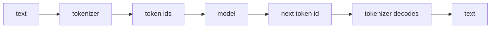

# Tokens: how text becomes numbers

Networks work with numbers, so text is first cut into **tokens**, and each token gets an id. Tokens are usually pieces of words: common words are one token, rare words are split.

```text
"Tokenization isn't magic"  ->  ["Token", "ization", " isn", "'t", " magic"]  ->  [3404, 2065, 4113, 470, 11204]
```

(The pieces and ids differ between models; every model family has its own tokenizer.)

## Byte-pair encoding, by hand

Most LLMs use **byte-pair encoding (BPE)**: start from single characters (in practice, bytes), then repeatedly merge the most frequent neighbouring pair into a new token. Here is the idea in a few lines:

```python
from collections import Counter

def most_common_pair(words):
    pairs = Counter()
    for w, n in words.items():
        for a, b in zip(w, w[1:]):
            pairs[(a, b)] += n
    return pairs.most_common(1)[0][0]

def merge(words, pair):
    out = {}
    for w, n in words.items():
        new, i = [], 0
        while i < len(w):
            if i + 1 < len(w) and (w[i], w[i + 1]) == pair:
                new.append(w[i] + w[i + 1]); i += 2
            else:
                new.append(w[i]); i += 1
        out[tuple(new)] = n
    return out

corpus = {"lower": 5, "lowest": 2, "newer": 6, "wider": 3}
words = {tuple(w): n for w, n in corpus.items()}
for step in range(4):
    pair = most_common_pair(words)
    words = merge(words, pair)
    print(step + 1, pair, list(words))
```

After four merges, frequent pieces such as `er`, `wer` and `lo` have become single tokens. Real tokenizers do tens of thousands of merges on huge corpora, giving vocabularies of roughly 30,000 to 200,000 tokens.

## Why tokens matter to you

- **Cost and limits are in tokens.** Prices, context windows and speed are all per token. In English, one token is about three quarters of a word on average.
- **Languages differ.** Text in Arabic and many other languages often needs more tokens for the same meaning than English, depending on the tokenizer, so it can cost more and fill the context window faster. Measure with your provider's token counter.
- **Strange failures come from tokens.** Counting letters in a word, reversing strings or simple arithmetic on long numbers are hard partly because the model sees tokens, not characters.



## Optional videos

The lesson above is complete on its own. These go deeper, if you like learning by watching.

**Let's build the GPT Tokenizer (Andrej Karpathy)**

https://www.youtube.com/watch?v=zduSFxRajkE
