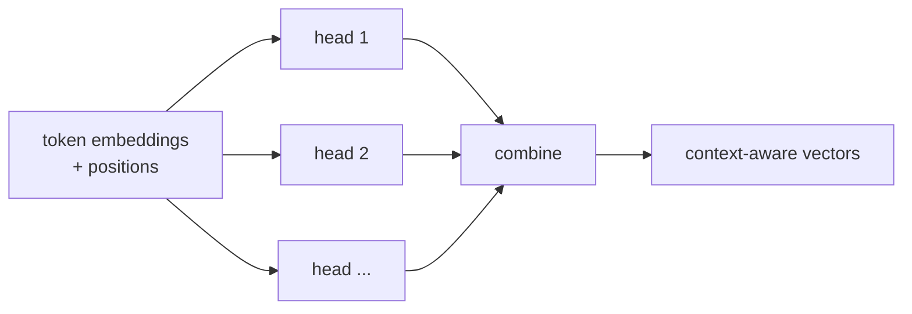

# Embeddings and attention

## Embeddings: tokens as vectors

Each token id is turned into a vector, its **embedding**: a list of a few thousand numbers learned in training. Tokens used in similar ways end up with similar vectors, so "Cairo" lands near "Alexandria" and far from "banana". A position signal is added, so the model also knows word order.

But a single token's vector can't hold its meaning in context: "bank" in "river bank" and "bank account" starts from the same vector. **Attention** is how context changes it.

## Attention in three steps

For every token, the model computes three vectors from its embedding:

- a **query**: what am I looking for?
- a **key**: what do I contain?
- a **value**: what do I pass on if someone attends to me?

Each token compares its query with every earlier token's key (a dot product), turns those scores into weights with softmax, and takes a weighted average of the values. The result is a new vector for the token that mixes in the context it found relevant.

```python
import numpy as np

def softmax(x, axis=-1):
    x = x - x.max(axis=axis, keepdims=True)
    e = np.exp(x)
    return e / e.sum(axis=axis, keepdims=True)

def self_attention(X, Wq, Wk, Wv):
    """X: (tokens, d). Causal: each token sees only itself and earlier tokens."""
    Q, K, V = X @ Wq, X @ Wk, X @ Wv
    scores = Q @ K.T / np.sqrt(K.shape[1])          # (tokens, tokens)
    future = np.triu(np.ones_like(scores), k=1).astype(bool)
    scores[future] = -np.inf                         # no peeking at later tokens
    weights = softmax(scores)
    return weights @ V, weights

rng = np.random.default_rng(0)
n, d = 4, 8                                          # 4 tokens, 8-dimensional embeddings
X = rng.normal(size=(n, d))
Wq, Wk, Wv = (rng.normal(size=(d, d)) for _ in range(3))
out, w = self_attention(X, Wq, Wk, Wv)
print(out.shape)            # (4, 8): one new vector per token
print(w.round(2))           # row i: how much token i attends to tokens 0..i
assert np.allclose(w.sum(axis=1), 1) and np.allclose(np.triu(w, 1), 0)
```

The weight matrix is lower-triangular: token 3 can look at tokens 0 to 3, never at the future. That's what makes the model a next-token predictor: during training it can't cheat by seeing the word it must predict.

## Many heads

Real models run many attention **heads** in parallel, each with its own query, key and value matrices, so one head can track grammar while another tracks which name a pronoun refers to. Their outputs are combined.



## Optional videos

The lesson above is complete on its own. These go deeper, if you like learning by watching.

**Attention in transformers, step by step (3Blue1Brown, chapter 6)**

https://www.youtube.com/watch?v=eMlx5fFNoYc
