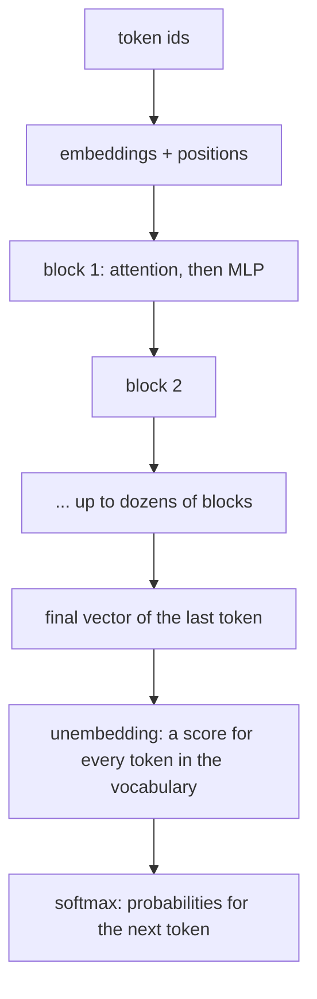

# The transformer, end to end

Attention is one part of a **transformer block**. A model stacks dozens of identical blocks; each one refines every token's vector a little more.



## Inside a block

1. **Attention:** tokens exchange information (previous lesson).
2. **MLP (feed-forward network):** each token's vector goes through a small two-layer network on its own. Research such as 3Blue1Brown's explainer suggests much of the model's stored factual knowledge lives in these layers.
3. **Residual connections:** each part *adds* its result to the vector instead of replacing it, so information flows through many layers and training stays stable.
4. **Normalization:** keeps the numbers in a healthy range.

## Where the parameters are

For a model with embedding size d, each block has about 4d² parameters in attention and 8d² in the MLP. A rough estimate of the total is 12 × layers × d².

```python
def approx_params(layers, d):
    return 12 * layers * d * d

for name, layers, d in [("GPT-2 small", 12, 768), ("GPT-3", 96, 12288)]:
    print(f"{name}: about {approx_params(layers, d) / 1e9:.2f} billion (without embeddings)")
```

GPT-3's published size is 175 billion parameters, and the formula gives about 174 billion: the blocks are almost all of it.

## Why transformers won

Earlier language models (RNNs) read text one token at a time, which is slow to train. A transformer processes all tokens of a training text **in parallel**, which fits GPUs perfectly, and attention connects distant words directly. That made it practical to train on trillions of tokens, and scale turned out to matter more than almost anything else.

## The cost of attention

Every token attends to every earlier token, so attention's work grows with the square of the context length. That is one reason long contexts are expensive, and why techniques like the KV cache (module 4) and efficient attention kernels exist.

## Optional videos

The lesson above is complete on its own. These go deeper, if you like learning by watching.

**Transformers, the tech behind LLMs (3Blue1Brown, Deep Learning chapter 5)**

https://www.youtube.com/watch?v=wjZofJX0v4M

**How might LLMs store facts (3Blue1Brown, chapter 7)**

https://www.youtube.com/watch?v=9-Jl0dxWQs8

**Let's build GPT: from scratch, in code, spelled out (Andrej Karpathy)**

https://www.youtube.com/watch?v=kCc8FmEb1nY
