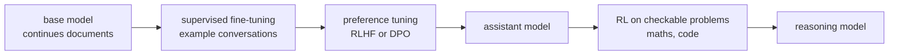

# From base model to assistant: fine-tuning, preferences and reasoning

## 1. Supervised fine-tuning (SFT)

Train further on many conversations of the form *question → ideal answer*, written or reviewed by people (and increasingly by other models). The model learns the *format* of being an assistant: answer the question, follow instructions, use the chat template with roles. Tens of thousands of good examples change behaviour a lot; they add little new knowledge.

## 2. Preference tuning

Good answers are easier to compare than to write. People (or models) see two answers to the same prompt and pick the better one.

- **RLHF** (reinforcement learning from human feedback): train a **reward model** to predict which answer people prefer, then use reinforcement learning to make the assistant produce higher-reward answers.
- **DPO** (direct preference optimization, 2023): learn directly from the pairs, without a separate reward model. Simpler and widely used.

This stage shapes helpfulness, tone, honesty and refusals of harmful requests.

## 3. Reasoning with reinforcement learning

Since 2024, labs train models with reinforcement learning on problems whose answers can be **checked automatically**: maths with known answers, code with tests. The model is rewarded only for correct final answers, and learns by itself to think step by step, check its work and backtrack. DeepSeek-R1 (January 2025) published this approach openly. These **reasoning models** write a long hidden or visible chain of thought before answering: better on hard problems, slower and more expensive on all of them.

## What each stage gives and doesn't give

| Stage | Gives | Doesn't give |
|---|---|---|
| Pretraining | knowledge, language, raw ability | helpfulness, instruction following |
| SFT | the assistant format, following instructions | much new knowledge |
| Preference tuning | better judgement of good answers, tone, refusals | guaranteed truthfulness |
| Reasoning RL | longer, self-checking thinking on hard problems | cheap or fast answers |

You can fine-tune open models yourself, usually with **LoRA** (training small added matrices instead of all weights), but for most applications you get further with good prompts, retrieval and tools, as the last module shows.

## Optional videos

The lesson above is complete on its own. These go deeper, if you like learning by watching.

**Deep Dive into LLMs like ChatGPT (Andrej Karpathy, 3.5 hours)**

https://www.youtube.com/watch?v=7xTGNNLPyMI
