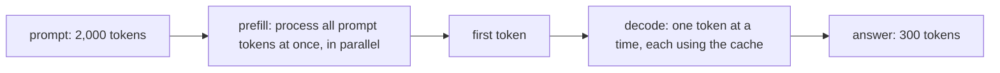

# Inference: speed, memory and context windows

Running a trained model is called **inference**. Knowing what makes it slow or expensive helps you design apps, choose models and answer interview questions.

## Two phases

- **Prefill** reads the whole prompt in parallel. It sets the **time to first token (TTFT)**, what users feel as "it started answering". Longer prompts mean longer prefill.
- **Decode** produces tokens one by one. It sets **tokens per second**. Longer answers mean longer decode.

## The KV cache

During decode, each new token attends to all earlier tokens. Recomputing their keys and values every step would be wasteful, so they're stored in the **KV cache**. It makes decoding fast but takes GPU memory that grows with context length and with the number of users served together. For a 70-billion-parameter model it can be hundreds of kilobytes per token, so a single very long conversation can take gigabytes.

## Context windows

The **context window** is the maximum number of tokens (prompt plus answer) the model handles. Windows grew from a few thousand tokens to hundreds of thousands and more. But:

- longer contexts cost more and slow the first token;
- models use information at the start and end of long contexts more reliably than in the middle;
- quality usually drops before the window is full.

So fill the window with what's needed, not everything you have.

## Making models smaller and faster

| Technique | Idea | Trade-off |
|---|---|---|
| **Quantization** | store weights in 8 or 4 bits instead of 16 | much less memory, small quality loss to measure |
| **Distillation** | train a small model to imitate a big one | cheaper, but weaker outside what it was trained on |
| **Mixture of Experts** | each token uses only some of many expert sub-networks | big capacity, lower compute per token, still needs memory for all experts |
| **Batching** | serve many users together on one GPU | higher throughput, a bit more latency for each |
| **Speculative decoding** | a small model drafts tokens, the big model checks several at once | faster with the same output |

## Memory rule of thumb

Weights need parameters × bytes per parameter: an 8B model is about 16 GB in 16-bit and about 4 to 5 GB in 4-bit, which is why quantized models run on laptops with tools like Ollama or llama.cpp.
