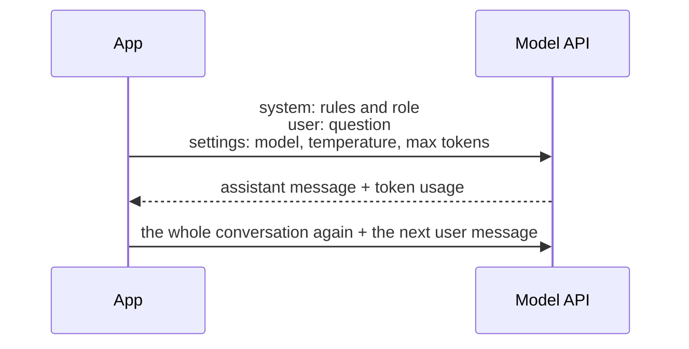

# Using LLMs well: APIs and prompts

## The chat API

Almost every provider's API looks the same: you send a list of **messages** with roles, settings, and optionally **tools**; you get back a message.

The API is **stateless**: each request contains the whole conversation so far. Memory is something your app builds by resending history (and trimming or summarising it).

## Prompts that work

| Do | Example |
|---|---|
| Give the role and the goal | "You are a support agent for an online shop. Resolve the customer's issue in one reply." |
| Give context the model can't know | the customer's order, the relevant policy text |
| Be specific about the output | "Reply in at most 3 sentences, in the customer's language." |
| Show examples (few-shot) for tricky formats | two short input-output pairs |
| Separate instructions from data | put documents or user text between clear tags |
| Say what to do when unsure | "If the policy doesn't cover it, say you'll ask a colleague." |

Clear beats clever: there's no magic phrase. If the output is wrong, first check whether the model had the information and the instructions it needed.

## Structured output

When code reads the answer, ask for JSON that matches a schema; many APIs can enforce it. Validate it anyway (for example with Pydantic) and retry with the error message if it fails.

## Choosing a model

| Need | Usually |
|---|---|
| Hard reasoning, planning, tricky code | a large or reasoning model |
| High-volume classification or extraction | a small, fast model, checked on your data |
| Private data that can't leave your servers | an open model you host |
| Images or documents as input | a multimodal model |

Measure on 30 to 50 of your own examples before deciding; public benchmark rankings rarely match your task exactly.

## Optional videos

The lesson above is complete on its own. These go deeper, if you like learning by watching.

**How I use LLMs (Andrej Karpathy)**

https://www.youtube.com/watch?v=EWvNQjAaOHw
