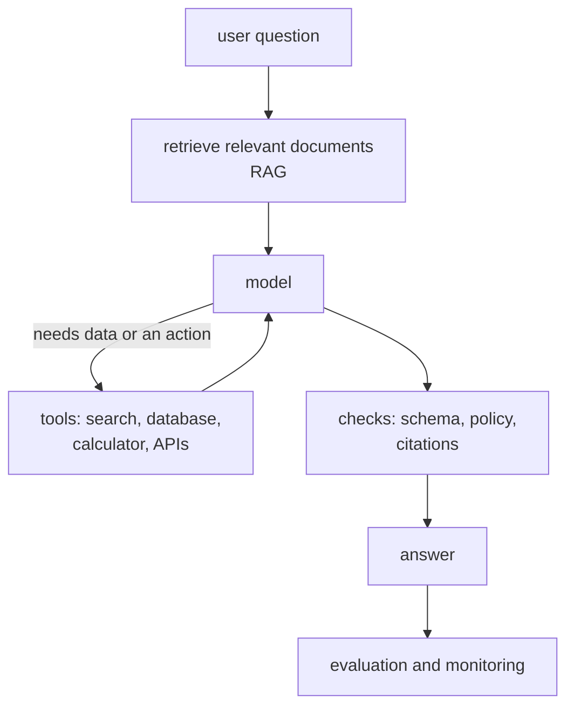

# Beyond the prompt: RAG, tools, evaluation and limits

A model alone knows only its training data and can only produce text. Real applications give it knowledge, actions and checks.

## RAG: give it knowledge

**Retrieval-augmented generation** finds the passages relevant to a question (with keyword search, embedding search, or both) and puts them in the prompt, asking the model to answer from them and cite them. Use it for your own or fresh information. It beats fine-tuning for knowledge, because documents stay editable, citable and permissioned.

## Tools: let it act

With **tool calling**, the model returns a request ("call `get_order` with `A-17`"), your code runs it, and the result goes back. Loops of tool calls are **agents**. Keep control in code: allowed tools only, validated arguments, limits on steps, and human approval for anything that can't be undone.

## Evaluation: know if it works

You can't judge an LLM app by trying five questions. Build a set of real examples with expected results, measure automatically on every change, read failures, and fix the biggest category first. Some checks are code (valid JSON? right category?); others use a model as a judge, which you first check against your own labels.

## Limits to design around

| Limit | Design response |
|---|---|
| Hallucination | ground in sources, require citations, allow "I don't know", evaluate faithfulness |
| Prompt injection: instructions hidden in documents, emails or web pages | treat outside text as data, limit tool permissions, require approval for risky actions |
| Privacy | send only the data the task needs; redact personal data in logs |
| Bias and uneven quality across languages | test on your users' languages and groups |
| Cost and latency | smaller models where possible, caching, shorter prompts, streaming |

## Where to go next

In the library: *LangChain and LangGraph: build agents with v1* to build agents with tools and memory, and the *Get hired as an AI engineer* series to build and evaluate full RAG and agent projects.
