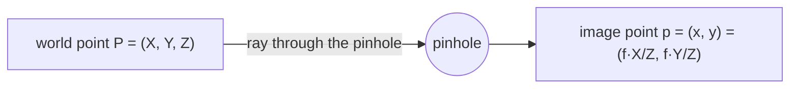

# Image formation: the pinhole camera

> This course follows the topics of MIT's 6.801 *Machine Vision* (Fall 2020, Prof. Berthold Horn), whose lectures are free on MIT OpenCourseWare. The lessons here are written from scratch and complete on their own; the lecture videos are optional and go deeper into the maths.

**Machine vision**, in Horn's sense, means recovering facts about the 3-D world (shape, position, motion, distance) from images, using the physics of how images are made. It's what industrial inspection, robot guidance and measurement systems rely on: answers in millimetres and degrees, with known accuracy.

## Perspective projection

Model the camera as a **pinhole**: light from a point in the world passes through one point (the centre of projection) and lands on the image plane at distance f (the focal length) behind it.



With the camera looking along Z:

x = f · X / Z,   y = f · Y / Z

Everything in this course grows from those two equations. They say:

- **Far things look small:** image size falls as 1/Z.
- **Depth is lost:** every point on the same ray lands on the same pixel. A big object far away and a small one nearby can look identical. Recovering Z needs more information: motion, two cameras, shading, or known sizes.
- **Parallel lines meet:** lines parallel in the world converge in the image at a **vanishing point**.

```python
import numpy as np

def project(P, f):
    """P: (n, 3) world points in camera coordinates (Z forward). Returns (n, 2) image points."""
    P = np.asarray(P, float)
    return f * P[:, :2] / P[:, 2:3]

f = 800.0                                  # focal length in pixels
pole_near = [[0, -1, 5], [0, 1, 5]]        # a 2 m tall pole, 5 m away
pole_far = [[0, -1, 20], [0, 1, 20]]       # the same pole, 20 m away
for pts in (pole_near, pole_far):
    p = project(pts, f)
    print("image height:", p[1, 1] - p[0, 1], "pixels")      # 320, then 80: four times farther, four times smaller

# two parallel rails, 1.5 m apart, going away from the camera
Z = np.linspace(2, 1000, 5)
left = project(np.c_[np.full_like(Z, -0.75), np.full_like(Z, 1.6), Z], f)
right = project(np.c_[np.full_like(Z, 0.75), np.full_like(Z, 1.6), Z], f)
print(np.round(left[-1], 1), np.round(right[-1], 1))   # both approach (0, 0): the vanishing point
```

## Orthographic projection

When an object's depth range is small compared with its distance (a part under a telephoto lens, a satellite image), perspective is close to **orthographic** projection: x = s·X, y = s·Y, with one scale factor. Many inspection algorithms use it because it's simpler and nearly exact for their setups.

## From the image plane to pixels

Real cameras add pixel size, the image centre (**principal point**) and lens distortion. These **intrinsic parameters** are found by **calibration** (module 3).

## Optional videos

The lesson above is complete on its own. These go deeper, if you like learning by watching.

**MIT 6.801 Machine Vision, Lecture 1: introduction to machine vision (Berthold Horn, MIT OpenCourseWare)**

https://www.youtube.com/watch?v=tY2gczObpfU

**MIT 6.801 Machine Vision, Lecture 2: image formation, perspective projection, motion field (Berthold Horn, MIT OpenCourseWare)**

https://www.youtube.com/watch?v=uM5AoUgCA00
