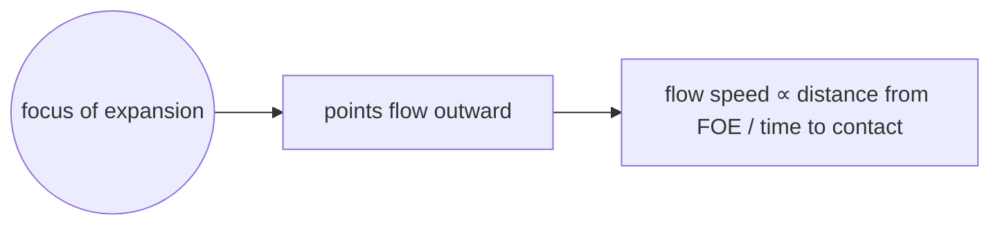

# Motion field, time to contact and focus of expansion

When the camera or the world moves, image points move. The **motion field** is the 2-D motion of image points caused by 3-D motion. From it, surprisingly much can be recovered, even without knowing distances.

## Moving straight ahead

Take a camera moving forward along its axis with speed W toward a surface at distance Z. A point at image position x = f·X/Z changes as Z shrinks:

dx/dt = x · W / Z

So points flow **outward from the centre**, faster when far from the centre and when the surface is close.



## Focus of expansion

For general forward motion, all flow vectors point away from one image point, the **focus of expansion (FOE)**: the point you're heading towards. A driver, a landing pilot or a drone can find it from the flow alone.

## Time to contact

Divide distance by closing speed: **time to contact** T = Z / W. Remarkably, it can be measured from the image **without knowing Z or W**: an object's image size s grows as 1/Z, so

T = s / (ds/dt)

```python
import numpy as np

f, real_width = 800.0, 1.8            # a car 1.8 m wide
Z0, W, dt = 30.0, 10.0, 0.1           # 30 m ahead, closing at 10 m/s, frames every 0.1 s
t = np.arange(0, 1.0, dt)
Z = Z0 - W * t
s = f * real_width / Z                # image width in pixels at each frame

ttc = s[:-1] / (np.diff(s) / dt)      # uses only image sizes
print(np.round(ttc[:4], 2))           # 2.9, 2.8, 2.7, 2.6 seconds: frame differences lag the truth by about one frame
print("true:", np.round(Z[:4] / W, 2))
```

The estimate needs only how fast the image grows: no camera calibration, no distance. Horn's group and others used this for collision warning chips that run with very little computation.

## Why it matters

Motion gives depth cues that a single image can't: nearer things move faster across the image (**motion parallax**). The next module recovers the motion field itself from changing brightness: **optical flow**.

## Optional videos

The lesson above is complete on its own. These go deeper, if you like learning by watching.

**MIT 6.801 Machine Vision, Lecture 3: time to contact, focus of expansion (Berthold Horn, MIT OpenCourseWare)**

https://www.youtube.com/watch?v=t9w_WuyVJ-A
