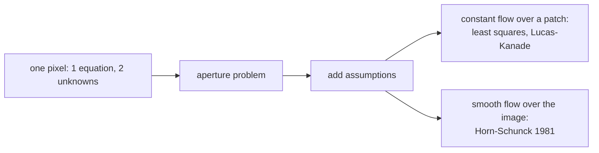

# Optical flow: motion from brightness

We can't see motion directly, only brightness changing over time. **Optical flow** estimates the motion field from those changes.

## The brightness constancy constraint

Assume a moving point keeps its brightness E. Then for small motions (u, v) in pixels per frame:

E_x · u + E_y · v + E_t = 0

where E_x, E_y are the brightness gradients in space and E_t the change over time at that pixel. One equation, two unknowns: at a single pixel, you can only find the motion component **along the gradient**. This is the **aperture problem**: through a small window, a moving straight edge only shows motion across it, never along it.



## Solving over a patch

If the whole patch moves together, every pixel gives one equation and least squares finds (u, v). This works when the patch has gradients in more than one direction (a corner, texture), and fails on a plain straight edge, which is the aperture problem again.

```python
import numpy as np

def flow_patch(E0, E1):
    """Constant-flow estimate for a whole patch from two frames (least squares)."""
    Ex = (np.gradient(E0, axis=1) + np.gradient(E1, axis=1)) / 2
    Ey = (np.gradient(E0, axis=0) + np.gradient(E1, axis=0)) / 2
    Et = E1 - E0
    A = np.c_[Ex.ravel(), Ey.ravel()]
    uv, *_ = np.linalg.lstsq(A, -Et.ravel(), rcond=None)
    return uv, np.linalg.cond(A.T @ A)

y, x = np.mgrid[0:64, 0:64].astype(float)
def blob(cx, cy):   # a smooth textured pattern
    return np.sin(x / 5 - cx / 5) + np.cos(y / 7 - cy / 7)

uv, cond = flow_patch(blob(0, 0), blob(0.6, -0.3))          # true motion: right 0.6, up 0.3
print(np.round(uv, 2), "condition number", round(cond, 1))  # close to [0.6, -0.3]

edge0 = np.tanh((x - 32) / 3); edge1 = np.tanh((x - 32.5) / 3)   # a vertical edge moving right
uv, cond = flow_patch(edge0, edge1)
print(np.round(uv, 2), "condition number", f"{cond:.1e}")   # u found, v undetermined: huge condition number
```

The **condition number** of the 2×2 matrix tells you whether the patch can be trusted: small for textured patches, huge for a straight edge. Good flow methods report this confidence, and smoothness-based methods like Horn and Schunck's (1981) fill in edge regions from their neighbours.

## Uses

Video stabilisation, tracking, motion detection, structure from motion, the optical mouse (next lesson), and as an input to learned video models.

## Optional videos

The lesson above is complete on its own. These go deeper, if you like learning by watching.

**MIT 6.801 Machine Vision, Lecture 4: fixed optical flow, optical mouse (Berthold Horn, MIT OpenCourseWare)**

https://www.youtube.com/watch?v=3NarS3QpaU0
