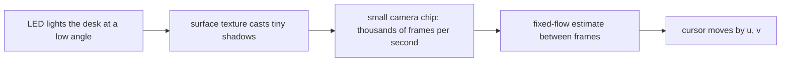

# Fixed flow, the optical mouse, and direct methods

## The optical mouse

An optical mouse is a tiny camera looking at the desk, taking thousands of small images a second (often around 18×18 to 30×30 pixels). Between frames, the whole image shifts by the same amount: **fixed flow**. That's the easiest flow problem: one (u, v) for the whole image, solved by least squares over every pixel, exactly like the patch method in the last lesson, or by finding the shift that best matches the two frames.

Why it works and when it fails:

- Low-angle light turns fine paper or wood texture into strong brightness patterns, so gradients exist in all directions (no aperture problem).
- On glass or a perfectly uniform glossy surface there's no texture, the least-squares system is ill-conditioned, and the cursor stops or jumps: the condition number from the last lesson, in a product you own.

## Direct methods

Many classic pipelines first find **features** (corners), match them, then compute motion. **Direct methods** skip features and use the brightness constraint at *every* pixel together with a motion model:

| Motion model | Unknowns | Example use |
|---|---|---|
| translation | 2 (u, v) | optical mouse, image stabilisation |
| rotation about the optical axis + translation | 3 | a document sliding and turning on a scanner |
| camera rotation only | 3 | a camera on a tripod |
| camera translation toward a plane | 3 (plus the plane) | landing, time to contact |

Using every pixel makes direct methods accurate (to a small fraction of a pixel) and robust to noise, provided the motion model fits and the motion between frames is small. For bigger motions, they run **coarse to fine**: estimate on a blurred, shrunk image first, then refine at full resolution.

## Takeaway

Choose the simplest motion model that describes your situation. Fewer unknowns means more equations per unknown, so the estimate is more precise and less sensitive to noise, the same reasoning you'll use for calibration and alignment.

## Optional videos

The lesson above is complete on its own. These go deeper, if you like learning by watching.

**MIT 6.801 Machine Vision, Lecture 4: fixed optical flow, optical mouse (Berthold Horn, MIT OpenCourseWare)**

https://www.youtube.com/watch?v=3NarS3QpaU0
