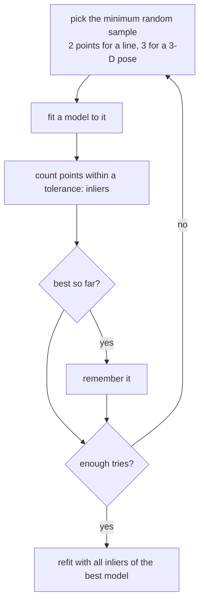

# Absolute orientation and RANSAC

## Absolute orientation

You have the same points measured in two coordinate systems: say, points on a part from a 3-D scanner and the same points in the CAD model. Find the rotation R and translation t that best map one onto the other. Horn published a closed-form solution in 1987 (using unit quaternions); the SVD version below gives the same answer and is the one most code uses.

1. Subtract each set's centroid.
2. Build the 3×3 cross-covariance matrix of the centred points.
3. Its SVD gives the best rotation; a sign check makes sure it's a rotation, not a reflection.
4. The translation maps one centroid to the other.

```python
import numpy as np

def absolute_orientation(A, B):
    """Find R, t minimising the squared error of R @ a + t ≈ b over matched rows of A and B."""
    ca, cb = A.mean(0), B.mean(0)
    H = (A - ca).T @ (B - cb)
    U, S, Vt = np.linalg.svd(H)
    D = np.diag([1, 1, np.sign(np.linalg.det(Vt.T @ U.T))])
    R = Vt.T @ D @ U.T
    return R, cb - R @ ca

rng = np.random.default_rng(0)
angle = np.radians(30)
R_true = np.array([[np.cos(angle), -np.sin(angle), 0], [np.sin(angle), np.cos(angle), 0], [0, 0, 1]])
t_true = np.array([0.5, -1.0, 2.0])
A = rng.normal(size=(20, 3))
B = A @ R_true.T + t_true + rng.normal(scale=0.01, size=A.shape)    # measured with 1 cm noise
R, t = absolute_orientation(A, B)
print(np.round(R, 3)); print(np.round(t, 3))
```

## When some matches are wrong: RANSAC

Real matches include **outliers** (a wrong correspondence, a reflection, a speck of dust). Least squares lets one bad point pull the whole answer away. **RANSAC** (random sample consensus, Fischler and Bolles, 1981):



```python
x = np.linspace(0, 10, 50)
y = 2 * x + 1 + rng.normal(scale=0.1, size=50)
y[::5] += rng.uniform(10, 30, 10)                 # 20% gross outliers

best = None
for _ in range(200):
    i, j = rng.choice(50, 2, replace=False)
    if x[i] == x[j]:
        continue
    m = (y[j] - y[i]) / (x[j] - x[i]); b = y[i] - m * x[i]
    inliers = np.abs(y - (m * x + b)) < 0.5
    if best is None or inliers.sum() > best.sum():
        best = inliers
m, b = np.polyfit(x[best], y[best], 1)
print("RANSAC:", round(m, 3), round(b, 3), "| plain least squares:", np.round(np.polyfit(x, y, 1), 3))
```

RANSAC recovers slope 2 and intercept 1; plain least squares is pulled off by the outliers. The number of tries needed grows quickly with the sample size and the outlier fraction, which is why minimal samples matter.

## Optional videos

The lesson above is complete on its own. These go deeper, if you like learning by watching.

**MIT 6.801 Machine Vision, Lecture 19: absolute orientation, RANSAC (Berthold Horn, MIT OpenCourseWare)**

https://www.youtube.com/watch?v=kigLhcTm_gg

**MIT 6.801 Machine Vision, Lecture 20: space of rotations, binocular stereo (Berthold Horn, MIT OpenCourseWare)**

https://www.youtube.com/watch?v=Mcy-LlcD8jI
