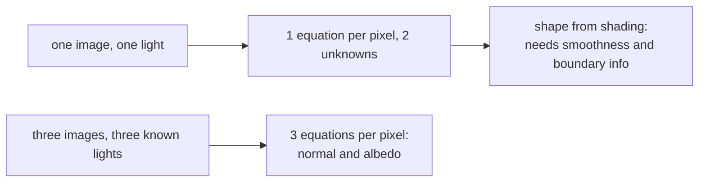

# Reflectance, the reflectance map and photometric stereo

Shading is information: a surface looks brighter where it faces the light. Horn's insight was to make that precise and run it backwards, from brightness to shape.

## Lambertian surfaces

A matte (**Lambertian**) surface looks equally bright from every viewing direction. Its brightness depends only on the angle between the surface normal n and the direction to the light s:

E = ρ · max(0, n · s)

where ρ is the **albedo** (how much light the surface reflects). Paper, chalk and unpolished stone are close to Lambertian; metal and plastic add shiny highlights.

## The reflectance map

Describe a surface's orientation by its gradient (p, q) = (∂z/∂x, ∂z/∂y). For a given light and material, the **reflectance map** R(p, q) gives the brightness of a patch with that orientation. Brightness E(x, y) = R(p, q) is one equation for two unknowns at each pixel: one image doesn't fix the orientation (sound familiar?).



## Photometric stereo

Keep the camera and object still, and take images under **three or more known light directions**. Each pixel then gets three brightness values, giving three linear equations for the scaled normal ρ·n. Solve per pixel; the length of the solution is the albedo.

```python
import numpy as np

S = np.array([[0.0, 0.0, 1.0],          # three known light directions (unit vectors)
              [0.7, 0.0, 0.714],
              [0.0, 0.7, 0.714]])

# a hemisphere: true normals and albedo
y, x = np.mgrid[-1:1:64j, -1:1:64j]
inside = x**2 + y**2 < 0.95
z = np.sqrt(np.clip(1 - x**2 - y**2, 0, None))
N_true = np.dstack([x, y, z]) / np.linalg.norm(np.dstack([x, y, z]), axis=2, keepdims=True)
albedo = 0.8

rng = np.random.default_rng(0)
images = [albedo * np.clip(N_true @ s, 0, None) + rng.normal(scale=0.01, size=x.shape) for s in S]   # three photos, with noise
E = np.stack(images, axis=-1)[inside]                                # (pixels, 3)
G = np.linalg.solve(S, E.T).T                                        # albedo × normal, per pixel
rho = np.linalg.norm(G, axis=1)
N = G / rho[:, None]
err = np.degrees(np.arccos(np.clip((N * N_true[inside]).sum(1), -1, 1)))
lit = (E > 0).all(1)                                                 # pixels lit by all three lights
print("albedo", round(float(np.median(rho[lit])), 3), " median normal error", round(float(np.median(err[lit])), 2), "degrees")
```

Photometric stereo is used in industrial inspection to find dents, scratches and embossed text that are invisible in ordinary photos, because it measures surface orientation directly. Its assumptions (known lights, a still scene, matte surfaces, no shadows) are easy to meet inside an inspection station.

## Optional videos

The lesson above is complete on its own. These go deeper, if you like learning by watching.

**MIT 6.801 Machine Vision, Lecture 6: photometric stereo (Berthold Horn, MIT OpenCourseWare)**

https://www.youtube.com/watch?v=OOrT17RsVxE

**MIT 6.801 Machine Vision, Lecture 7: reflectance map (Berthold Horn, MIT OpenCourseWare)**

https://www.youtube.com/watch?v=qqtEQsBjh28
