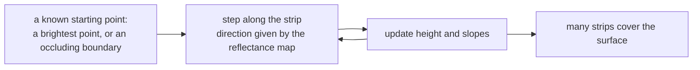

# Shape from shading

With one image and one light, can we still recover shape? People do it all the time: a shaded drawing looks three-dimensional. **Shape from shading** (Horn's PhD topic, 1970) shows how, and where it needs help.

## The problem

At each pixel, the image irradiance equation E(x, y) = R(p, q) gives one equation for two unknowns, the surface slopes p and q. But neighbouring pixels belong to one continuous surface, and that's the extra information.

## Characteristic strips

Horn showed that the equation can be solved along special curves, **characteristic strips**. Start from a point where you know the height and orientation, and the equation tells you which direction to step and how p, q and the height change along the way. Grow many such strips outward and you have the surface.

Where do starting points come from?

- **Singular points:** the brightest point of a Lambertian surface faces the light directly, so its orientation is known.
- **Occluding boundaries:** at the silhouette edge, the surface turns away from the viewer, so its normal is perpendicular to the line of sight and lies in the image plane.

## Variational methods

Instead of strips, many methods minimise one energy over the whole image: brightness error (E − R(p, q))² plus a **smoothness** term that penalises sudden changes in p and q. Iterating local updates gives a smooth surface that explains the image. This idea (data term plus smoothness term) is the same one behind Horn-Schunck optical flow, and it appears all over vision.

## Why it's hard in practice

- **Ambiguities:** a bump lit from above looks like a dent lit from below (the famous convex/concave illusion).
- **Unknown albedo:** a darker patch could be paint or a slope.
- **Shadows, highlights and inter-reflections** break the simple model.

That's why industry prefers photometric stereo (several lights) when it can, and why modern systems combine shading with other cues or with learned priors. But the reflectance map remains the right way to think about what brightness can and can't tell you.

## Optional videos

The lesson above is complete on its own. These go deeper, if you like learning by watching.

**MIT 6.801 Machine Vision, Lecture 8: shading, special cases (Berthold Horn, MIT OpenCourseWare)**

https://www.youtube.com/watch?v=LP7z6vVmnms

**MIT 6.801 Machine Vision, Lecture 10: characteristic strip expansion, shape from shading (Berthold Horn, MIT OpenCourseWare)**

https://www.youtube.com/watch?v=XSUjp-cDyeY
