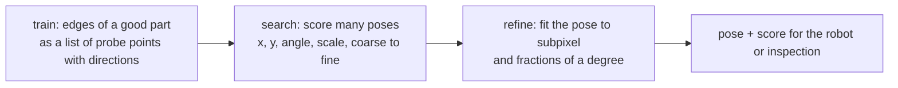

# Finding parts and measuring depth: alignment and stereo

## Pattern alignment in industry

A typical machine vision job: find a part on a conveyor and report its exact position and angle so a robot can pick it, or check that a chip is placed correctly on a circuit board. Horn's lectures describe the ideas behind Cognex's patented tools (**PatQuick** for fast search and **PatMax** for precise alignment):



Why not compare pixels directly (template matching)? Because lighting changes brightness, and parts rotate and vary. Comparing **edge positions and directions** is robust to lighting and contrast, and fitting a pose to many edge points with least squares gives accuracy far finer than a pixel: the same ideas as subpixel edges and absolute orientation, combined.

## Binocular stereo

Two cameras a known distance apart (the **baseline** B) see the same point at slightly different image positions. The difference along the line joining the cameras, the **disparity** d, gives depth:

Z = f · B / d

```python
import numpy as np

f, B = 800.0, 0.12                   # focal length in pixels, 12 cm between cameras
for d in [80.0, 20.0, 5.0, 4.0]:
    print(f"disparity {d:5.1f} px -> depth {f * B / d:6.2f} m")

# how a one-pixel matching error grows with distance
Z = np.array([1.0, 5.0, 20.0])
dZ = Z**2 / (f * B) * 1.0            # error for 1 pixel of disparity error
print("depth error for 1 px:", np.round(dZ, 3), "m")
```

Two lessons follow from Z = f·B/d:

- **Depth error grows with the square of distance.** Far objects have tiny disparities, and a one-pixel error becomes metres. Wider baselines and longer focal lengths help, at the cost of harder matching.
- **Matching is the hard part:** finding which pixel in the right image corresponds to each pixel in the left. After calibration and **rectification** (warping both images so matches lie on the same row), the search is one-dimensional along the row. Textureless walls and repeated patterns remain hard; projecting a light pattern (as many depth cameras do) adds texture.

The geometry that relates two arbitrary camera positions, **relative orientation**, is the two-camera version of absolute orientation, and it's what visual odometry and structure from motion solve frame after frame.

## Optional videos

The lesson above is complete on its own. These go deeper, if you like learning by watching.

**MIT 6.801 Machine Vision, Lecture 13: object detection, recognition and pose (PatQuick) (Berthold Horn, MIT OpenCourseWare)**

https://www.youtube.com/watch?v=lVfm6C51t_Y

**MIT 6.801 Machine Vision, Lecture 15: alignment, PatMax (Berthold Horn, MIT OpenCourseWare)**

https://www.youtube.com/watch?v=R1yLwFOfwwc

**MIT 6.801 Machine Vision, Lecture 20: space of rotations, binocular stereo (Berthold Horn, MIT OpenCourseWare)**

https://www.youtube.com/watch?v=Mcy-LlcD8jI

**MIT 6.801 Machine Vision, Lecture 21: relative orientation, camera calibration (Berthold Horn, MIT OpenCourseWare)**

https://www.youtube.com/watch?v=-n0cXgPSwOw
