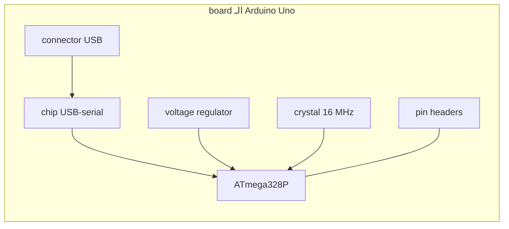

# ما هو الـ microcontroller

الـ **microcontroller** ‏(MCU) كمبيوتر صغير على chip واحد: ‏processor، وذاكرة للبرنامج (flash)، وذاكرة عمل (RAM)، و**pins** كثيرة تستطيع قراءة الأزرار والـ sensors أو تشغيل الـ LEDs والـ motors. يشغّل برنامجًا واحدًا، للأبد، من لحظة وصول الكهرباء. الغسالات ولوحات المفاتيح والألعاب وأجزاء السيارات والـ thermostats كلها فيها microcontrollers.

في هذا الكورس ستصمم board **خاصًا بك** للـ microcontroller حول **ATmega328P**، وهو الـ chip الموجود في Arduino Uno، ثم تبرمجه. يجب أن تعرف أساسيات الإلكترونيات وأن تكون صممت PCB بسيطًا في KiCad أولًا (الكورسان السابقان في هذا المسار).

## الـ Microcontroller مقابل board الـ Arduino

الـ Arduino Uno هو board جاهز: الـ ATmega328P زائد كل ما يحتاجه (الكهرباء، وclock، وطريقة لتحميل البرامج) وheaders لتركيب الأسلاك. وتصميم board خاص بك يعني:

- يمكن أن يكون **أصغر** وأرخص وبشكل مناسب لمشروعك
- تضع **ما تحتاجه فقط** (وتضيف الـ sensors والأزرار والـ connectors على الـ board مباشرة)
- تفهم كل جزء، وهذا يجعل الـ debugging أسهل بكثير

## داخل الـ ATmega328P

| الميزة | ATmega328P |
|---|---|
| الـ Processor | ‏AVR ‏8-bit، حتى 20 MHz ‏(16 MHz في Arduino) |
| ذاكرة البرنامج (flash) | ‏32 KB |
| الـ RAM | ‏2 KB |
| الـ EEPROM ‏(تحتفظ بالبيانات بدون كهرباء) | ‏1 KB |
| الـ Digital I/O pins | ‏23 ‏(في نسخة الـ DIP ذات 28 pin) |
| الـ Analog inputs ‏(ADC ‏10-bit) | 6 |
| الاتصال | ‏UART ‏(serial) وSPI وI²C |
| جهد التشغيل | من 1.8 إلى 5.5 V ‏(الـ 16 MHz تحتاج حوالي 4.5 V أو أكثر) |

أرقام صغيرة بمقاييس اليوم، لكنها أكثر من كافية لقراءة الـ sensors، والتحكم في المخرجات، والتحدث مع الكمبيوتر، وهو يستهلك كهرباء قليلة جدًا. والـ chip رخيص، وموثق جيدًا، ويُباع في package ‏DIP بـ 28 pin سهل اللحام، ويعمل مع عالم Arduino الضخم.

## ‏Microcontrollers أخرى ستقابلها

| العائلة | لماذا يختارها الناس |
|---|---|
| **ATmega328P** ‏(AVR) | بسيط، و5 V، ومناسب للـ breadboard؛ ممتاز للتعلم |
| **RP2040 / RP2350** ‏(Raspberry Pi) | سريع، ورخيص، وcoreان، وUSB جيد |
| **ESP32** | ‏Wi-Fi وBluetooth مدمجان؛ لمشاريع الـ IoT |
| **STM32** ‏(ARM Cortex-M) | حصان العمل في الصناعة؛ تشكيلة ضخمة |

كل ما تتعلمه هنا (الكهرباء، والـ decoupling، والـ clock، والـ reset، وheader البرمجة، والـ layout) ينطبق عليها كلها.

## الخلاصة

- الـ microcontroller كمبيوتر كامل على chip واحد يشغّل برنامجًا واحدًا من لحظة وصول الكهرباء.
- الـ Arduino Uno هو ATmega328P زائد أجزاء الكهرباء والـ clock والبرمجة؛ والـ board الخاص بك يستطيع نفس الشيء، أصغر.
- الـ ATmega328P: ‏8-bit، و16 MHz، و32 KB flash، و2 KB RAM، و23 I/O pin، وUART/SPI/I²C.

## فيديوهات اختيارية

الدرس أعلاه كامل وحده. هذه الفيديوهات للتعمق إن كنت تحب التعلم بالمشاهدة. الفيديوهات المكتوب بجانبها (بالإنجليزية) يمكنك تشغيل الترجمة لها (**CC**)، ثم **الإعدادات ← الترجمة ← ترجمة تلقائية ← العربية**.

**How do CPUs read machine code? (Ben Eater) (بالإنجليزية)**

https://www.youtube.com/watch?v=yl8vPW5hydQ
