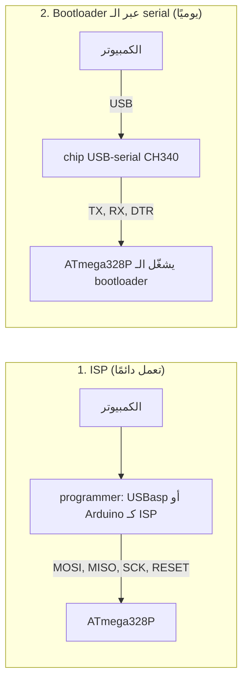

# تحميل البرامج على الـ chip

الـ microcontroller الجديد فارغ. وتوجد طريقتان لتحميل برنامج، والـ boards الجيدة تدعم الاثنتين.



## ‏1. الـ ISP: ‏in-system programming

الـ ATmega فيه واجهة برمجة مدمجة على pins الـ SPI. والـ **programmer** ‏(USBasp رخيص، أو أي Arduino يشغّل sketch ‏"ArduinoISP") يتصل عبر **ISP header قياسي بـ 6 pins**:

```text
ISP header (2x3, looking at the pins from above)
   MISO  1 ● ● 2  VCC
   SCK   3 ● ● 4  MOSI
   RESET 5 ● ● 6  GND
```

| pin الـ header | pin الـ ATmega328P |
|---|---|
| ‏1 MISO | ‏18 ‏(PB4) |
| ‏2 VCC | 7 |
| ‏3 SCK | ‏19 ‏(PB5) |
| ‏4 MOSI | ‏17 ‏(PB3) |
| ‏5 RESET | 1 |
| ‏6 GND | 8 |

الـ ISP يستطيع كل شيء: كتابة البرامج، وحرق الـ bootloader، وضبط الـ **fuses** ‏(إعدادات مثل "استخدم الـ crystal الخارجي"). **ضع دائمًا ISP header على الـ board**: لو حدث أي خطأ آخر، فهو طريقك للرجوع.

لاحظ أن PB5 هو SCK وأيضًا LED الـ D13. لا مشكلة: الـ LED سيومض فقط أثناء البرمجة.

## ‏2. الـ Bootloader

الـ **bootloader** برنامج صغير جدًا في آخر ذاكرة الـ flash. بعد الـ reset، يستمع على pins الـ serial لحظة: لو وصل برنامج جديد، يكتبه في الـ flash؛ وإن لم يصل، يشغّل برنامجك. وهكذا يُبرمج الـ Arduino عبر الـ USB بدون programmer.

تضع الـ bootloader مرة واحدة، بالـ ISP ‏("Burn Bootloader" في Arduino IDE). والـ chips التي تُباع "with Arduino bootloader" فيها بالفعل.

## ‏chip الـ USB-serial

الـ ATmega328P ليس فيه USB. و chip ‏**USB-to-serial** يترجم:

| الـ Chip | ملاحظات |
|---|---|
| **CH340** ‏(CH340C / CH340G) | رخيص وشائع؛ ونسخة "C" لا تحتاج crystal |
| **CP2102** | ‏drivers موثوقة في كل مكان |
| **FT232R** | الكلاسيكي، وأغلى |

التوصيلات (مع CH340C):

| CH340C | ATmega328P | ملاحظة |
|---|---|---|
| TXD | ‏2 ‏(RXD) | الـ TX يذهب إلى RX |
| RXD | ‏3 ‏(TXD) | الـ RX يذهب إلى TX |
| DTR ‏(أو RTS) | ‏1 ‏(RESET) **عبر 100 nF** | يعمل reset للـ chip عند بدء الرفع |
| D+ / D− | ‏D+ / D− في connector الـ USB | |
| VCC وGND | ‏5 V وGND | زائد decoupling ‏100 nF |

الـ **100 nF من DTR إلى RESET** يعطي auto-reset: عندما يفتح الكمبيوتر الـ port، ينخفض الـ DTR، فيرسل الـ capacitor نبضة منخفضة قصيرة إلى RESET، فيعيد الـ chip التشغيل، ويلتقط الـ bootloader الرفع. وبدونه ستضطر لضغط reset في اللحظة المناسبة بالضبط.

خيار أبسط: لا تضع chip الـ USB-serial على الـ board وأضف **header ‏"FTDI" بـ 6 pins** ‏(GND وCTS وVCC وTX وRX وDTR) لتوصيل كابل adapter ‏USB-serial جاهز. ‏board أصغر، و chip أقل للحام.

## الـ Fuses

الـ Fuses إعدادات مخزنة في الـ chip ‏(وليست fuses فعلية). والمهم منها:

- **مصدر الـ clock**: ‏crystal خارجي مقابل الـ 8 MHz الداخلي
- **قسمة الـ clock على 8**: الـ chips الجديدة تأتي مضبوطة على الداخلي 8 MHz ÷ 8 = ‏1 MHz!
- **حجم الـ bootloader** وهل يقفز إليه بعد الـ reset

حرق الـ bootloader من Arduino IDE يضبط أيضًا الـ fuses الصحيحة لـ board بأسلوب Uno. والـ fuses الخطأ للـ clock (مثلًا "external crystal" على board بدون crystal) تجعل الـ chip يبدو ميتًا حتى تعطيه clock، فراجع جيدًا قبل كتابة الـ fuses يدويًا.

## الخلاصة

- الـ ISP ‏(header بـ 6 pins إلى MOSI وMISO وSCK وRESET وVCC وGND) يعمل دائمًا؛ ضعه على كل board.
- الـ bootloader يسمح لك بالرفع عبر الـ serial؛ و chip ‏USB-serial ‏(CH340) أو header ‏FTDI يوصله بالكمبيوتر.
- اعكس TX/RX، وأضف 100 nF من DTR إلى RESET للـ auto-reset؛ والـ fuses تضبط مصدر الـ clock.

## فيديوهات اختيارية

الدرس أعلاه كامل وحده. هذه الفيديوهات للتعمق إن كنت تحب التعلم بالمشاهدة. الفيديوهات المكتوب بجانبها (بالإنجليزية) يمكنك تشغيل الترجمة لها (**CC**)، ثم **الإعدادات ← الترجمة ← ترجمة تلقائية ← العربية**.

**Burn the bootloader and upload to an ATmega328P on a breadboard, Arduino as ISP (DIY Hideout) (بالإنجليزية)**

https://www.youtube.com/watch?v=smr9EddIL3Q
