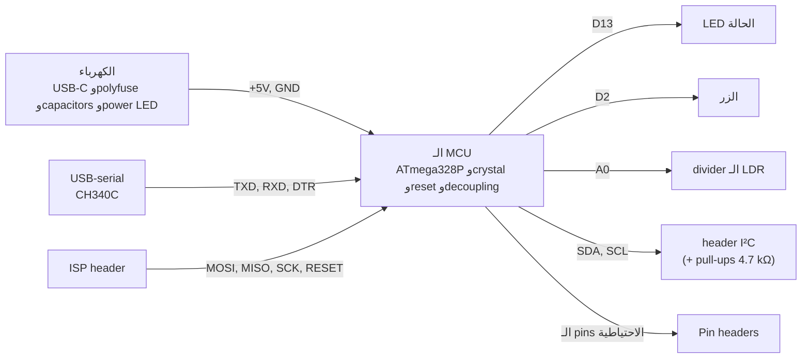

# الـ schematic الكامل للـ board

الآن اجمع كل شيء في board واحد في KiCad. ومثال الـ board لهذه الوحدة: **sensor board** صغير فيه:

- كهرباء وبرمجة عبر USB-C ‏(CH340C)
- ‏ATmega328P مع crystal وreset وISP header
- ‏LED للحالة، وزر، وsensor ضوء (LDR) على A0
- ‏header ‏I²C لموديول sensor حرارة
- ‏headers تُخرج الـ pins الاحتياطية

## نظّم الـ schematic في blocks

الـ schematics الكبيرة أسهل في القراءة والمراجعة عندما تُقسم إلى blocks وظيفية. ارسم كل block في منطقة خاصة به من الصفحة (أو في صفحات منفصلة بـ **hierarchical sheets** في KiCad)، تربطها **net labels**:



استخدم أسماء nets واضحة: `+5V` و`GND` و`USB_DP` و`USB_DN` و`MCU_RX` و`MCU_TX` و`DTR` و`RESET` و`SDA` و`SCL`. سمِّ الإشارات من وجهة نظر الـ microcontroller، فيسهل فحص تبادل TX/RX.

## الـ Blocks

**الكهرباء**: دائرة USB-C من الوحدة 2 ‏(VBUS، وpolyfuse، و10 µF، و100 nF، وpower LED، و5.1 kΩ على CC1 وCC2). وأضف PWR_FLAG على +5V وGND.

**الـ USB-serial**: ‏CH340C مع الـ decoupling ‏100 nF الخاص به؛ وD+ وD− إلى connector الـ USB؛ وTXD إلى `MCU_RX`، وRXD إلى `MCU_TX`؛ وDTR عبر 100 nF إلى `RESET`. راجع أرقام الـ pins في datasheet الـ CH340C والـ pin ‏V3 الخاص به (يتصل بـ VCC مع capacitor ‏100 nF عند العمل على 5 V).

**الـ MCU**: الدائرة الأساسية من الوحدة 2: ‏VCC وAVCC إلى +5V مع 100 nF لكل واحد، والـ GNDان، وAREF مع 100 nF إلى الـ ground، وcrystal ‏16 MHz مع 2 × 22 pF، وpull-up ‏10 kΩ للـ RESET، وزر reset.

**الـ ISP header**: الـ header ‏2×3 موصول بـ MISO وSCK وMOSI وRESET و+5V وGND.

**الـ I/O**: ‏LED + 330 Ω على D13؛ وزر على D2 إلى الـ ground ‏(internal pull-up في الكود؛ وأضف footprint لـ 10 kΩ خارجي على أي حال، وتستطيع تركه فارغًا)؛ وdivider من LDR + 10 kΩ على A0؛ وheader ‏I²C ‏(VCC وGND وSDA وSCL) مع **pull-ups ‏4.7 kΩ** على SDA وSCL.

## مراجعة الـ schematic

قبل الـ layout، راجع بعناية. الخطأ الذي تجده الآن لا يكلف شيئًا؛ وعلى board مصنّع يكلف طلبًا جديدًا.

```python
checks = [
    "VCC, AVCC to +5V; GND pins 8 and 22 to GND",
    "100 nF on VCC, AVCC, AREF and the CH340C",
    "crystal on pins 9 and 10 with two 22 pF to GND",
    "RESET: 10 kΩ pull-up, button to GND, 100 nF from DTR",
    "TX of each chip goes to RX of the other",
    "ISP header pin order matches the standard 2x3 layout",
    "USB-C: 5.1 kΩ on CC1 and CC2, D+ and D- not swapped",
    "I2C pull-ups present (and only once on the bus)",
    "PWR_FLAGs placed, ERC clean",
]
for i, c in enumerate(checks, 1):
    print(f"[ ] {i}. {c}")
```

```output
[ ] 1. VCC, AVCC to +5V; GND pins 8 and 22 to GND
[ ] 2. 100 nF on VCC, AVCC, AREF and the CH340C
[ ] 3. crystal on pins 9 and 10 with two 22 pF to GND
[ ] 4. RESET: 10 kΩ pull-up, button to GND, 100 nF from DTR
[ ] 5. TX of each chip goes to RX of the other
[ ] 6. ISP header pin order matches the standard 2x3 layout
[ ] 7. USB-C: 5.1 kΩ on CC1 and CC2, D+ and D- not swapped
[ ] 8. I2C pull-ups present (and only once on the bus)
[ ] 9. PWR_FLAGs placed, ERC clean
```

اطبعها، وعلّم كل بند وأنت تتتبع الـ schematic بقلم تحديد. وفكرة جيدة أيضًا أن تقارن تصميمك بالـ schematic المفتوح المصدر لـ Arduino Uno، الذي يبيّن نفس الـ blocks.

## ‏Footprints لـ board الـ microcontroller

| الجزء | سهل اللحام باليد | أصغر (تجميع المصنع) |
|---|---|---|
| ATmega328P | ‏DIP-28 ‏(في socket) | ‏TQFP-32 ‏(pitch ‏0.8 mm) |
| CH340C | SOIC-16 | SOIC-16 |
| الـ Crystal | ‏HC-49 ‏through-hole | ‏3225 SMD |
| الـ Passives | 0805 | 0603 |
| USB-C | ‏through-hole ‏"power only" | ‏SMD بـ 16 pin |

‏DIP-28 في socket اختيار ممتاز لأول board: لو تلف الـ chip، تستبدله.

## الخلاصة

- ارسم الـ board كـ blocks ‏(الكهرباء، وUSB-serial، والـ MCU، والـ ISP، والـ I/O) تربطها net labels واضحة.
- استخدم الدائرة الأساسية، ودائرة كهرباء USB-C، وحيلة الـ auto-reset من الدروس السابقة.
- راجع مقابل قائمة مطبوعة قبل الـ layout؛ واختر footprints تستطيع لحامها (DIP-28 في socket مريح).

## فيديوهات اختيارية

الدرس أعلاه كامل وحده. هذه الفيديوهات للتعمق إن كنت تحب التعلم بالمشاهدة. الفيديوهات المكتوب بجانبها (بالإنجليزية) يمكنك تشغيل الترجمة لها (**CC**)، ثم **الإعدادات ← الترجمة ← ترجمة تلقائية ← العربية**.

**KiCad STM32 PCB design, full tutorial (Phil's Lab) (بالإنجليزية)**

https://www.youtube.com/watch?v=aVUqaB0IMh4
