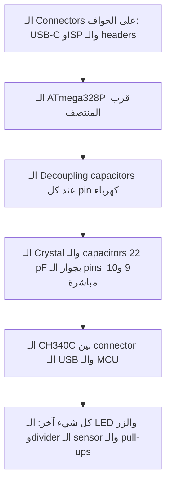

# قواعد الـ layout لـ boards الـ microcontrollers

القواعد العامة للـ layout من كورس الـ PCB ما زالت سارية. وboards الـ microcontroller تضيف قواعد قليلة تصنع الفرق بين board يعمل بثبات وآخر يتوقف "عشوائيًا".

## ترتيب وضع الأجزاء



## الـ Decoupling الصحيح

كل capacitor ‏100 nF يجب أن يكوّن **حلقة صغيرة جدًا** مع الـ pin الخاص به: من الـ capacitor إلى pin الـ VCC، ومن الـ capacitor إلى pin الـ GND ‏(أو via مباشرة لأسفل إلى الـ ground pour)، بأقصر ما يمكن.

```text
good:                         bad:
  VCC pin ── C ── via to GND    VCC pin ──────────────── C ── far away
  (a few mm)                    (the long track undoes the capacitor's job)
```

## الـ Crystal

الـ crystal أكثر جزء حساس في الـ board:

- الـ crystal والـ capacitorان الخاصان به **في حدود بضعة mm** من الـ pins ‏9 و10
- الـ tracks قصيرة ومباشرة؛ ولا إشارات أخرى تمر بينها أو تحتها
- ‏ground متصل تحت منطقة الـ crystal؛ وأطراف الـ ground للـ capacitors تذهب إليه مباشرة

الـ crystal الموضوع بشكل سيئ قد يعمل على مكتبك ثم يفشل في البدء عندما يبرد الجو، أو مع دفعة crystals مختلفة.

## الـ Ground

استخدم **ground pour متصلًا** على الطبقة السفلى، وأبقِه بلا قطع قدر الإمكان: ‏current كل إشارة يرجع عبر الـ ground الموجود تحت الـ track مباشرة، والقطع في الـ pour تجبره على طريق التفافي طويل (ضوضاء). ووصّل أغلب الـ tracks على الطبقة العليا لهذا السبب، واستخدم قفزات قصيرة على الطبقة السفلى فقط حيث يلزم. وأضف stitching vias بين مساحات الـ ground العليا والسفلى.

## خطوط بيانات الـ USB

الـ USB 2.0 بسرعة full speed ‏(التي يستخدمها CH340) متسامح، لكن عادات جيدة:

- وصّل **D+ وD− معًا** كزوج، جنبًا إلى جنب، بأطوال متقاربة، وقصيرين
- أبعدهما عن الـ crystal والإشارات السريعة الأخرى
- بدون stubs أو test points متدلية منهما

## ‏tracks الكهرباء

- ‏tracks ‏+5V وGND بعرض 0.5 mm أو أكثر (أو استخدم الـ pour للـ GND).
- وصّل الكهرباء من الـ connector إلى الـ capacitors أولًا، ثم إلى كل chip.

## اجعله سهل الاستخدام والـ debugging

- سمِّ كل pin في الـ headers على الـ silkscreen ‏(D2 وA0 وSDA وSCL و+5V وGND).
- علّم الـ pin رقم 1 في الـ ISP header والـ chips بوضوح.
- أضف **test points** ‏(pads صغيرة) على +5V وGND وRESET وTX وRX: ستريد وضع meter أو probe ‏scope هناك.
- ضع زر الـ reset حيث يصل إليه إصبع والـ board داخل علبته.
- اسم الـ board والإصدار والتاريخ على الـ silkscreen.

## الفحوص الأخيرة

شغّل الـ DRC، وانظر إلى الـ 3D model، واطبع 1:1 لتتأكد أن الـ DIP socket الحقيقي وconnector الـ USB-C والـ headers تناسب، وأعد قراءة قائمة مراجعة الـ schematic من الدرس السابق. ثم ولّد الـ Gerbers والـ drill files والـ BOM و(لتجميع المصنع) الـ position file، تمامًا كما في كورس الـ PCB.

## الخلاصة

- ضع الـ connectors، ثم الـ MCU، ثم الـ decoupling capacitors والـ crystal ملتصقة بالـ pins الخاصة بها.
- احتفظ بـ ground pour متصل؛ ووصّل D+/D− في الـ USB كزوج قصير بعيدًا عن الـ crystal.
- سمِّ كل شيء، وأضف test points، وشغّل فحوص الـ DRC والطباعة 1:1 المعتادة.

## فيديوهات اختيارية

الدرس أعلاه كامل وحده. هذه الفيديوهات للتعمق إن كنت تحب التعلم بالمشاهدة. الفيديوهات المكتوب بجانبها (بالإنجليزية) يمكنك تشغيل الترجمة لها (**CC**)، ثم **الإعدادات ← الترجمة ← ترجمة تلقائية ← العربية**.

**2-layer PCB design tips (Phil's Lab) (بالإنجليزية)**

https://www.youtube.com/watch?v=M6_an34wQJk
