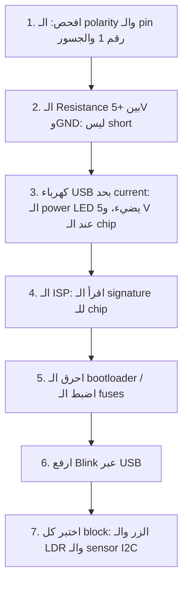

# التشغيل الأول والـ debugging

وصلت الـ boards ولحمت واحدًا. شغّله على مراحل، لكي تعرف بالضبط أي مرحلة فشلت عندما يكون هناك خطأ.



## مرحلة بمرحلة

**1 و2: قبل الكهرباء.** افحص اتجاه الـ chip ‏(شق الـ DIP socket!)، ووصلات لحام connector الـ USB-C ‏(الجسور بين pins الصغيرة جدًا شائعة)، وقِس بين +5V وGND: أي شيء أقل من حوالي 100 Ω معناه short.

**3: أول كهرباء.** استخدم port ‏USB مع USB meter بحد current، أو bench supply على 5 V بحد 100 mA. يجب أن يسحب الـ board من 10 إلى 40 mA. قِس 5 V عند الـ pin ‏7 والـ pin ‏20 للـ ATmega.

**4: الـ ISP.** وصّل الـ programmer واقرأ **الـ signature** للـ chip ‏(avrdude يطبعها):

```bash
avrdude -c usbasp -p m328p
```

```text
avrdude: Device signature = 0x1e950f (probably m328p)
```

‏signature صحيحة تثبت أن الكهرباء والـ ground والـ reset وpins الـ ISP كلها تعمل. ولو فشلت، افحص اتجاه الـ ISP header والـ pull-up الخاص بالـ RESET أولًا.

**5: الـ Bootloader.** في Arduino IDE: ‏Tools → Programmer → USBasp ‏(أو "Arduino as ISP")، ثم **Tools → Burn Bootloader**. وهذا يضبط أيضًا الـ fuses للـ crystal ‏16 MHz، فيكون الـ clock قد اختُبر أيضًا.

**6: الرفع عبر USB.** اختر port الـ CH340 وارفع Blink. ولو انتهت مهلة الرفع، فالمشتبه بهم المعتادون: ‏TX/RX مبدّلان، أو capacitor الـ DTR ناقص، أو driver الـ CH340.

**7: كل block.** ‏sketch اختبار صغير لكل ميزة: الزر يضيء الـ LED، وقيمة الـ LDR تتغير عندما تغطيه، والـ sensor ‏I²C يرد.

## الـ I²C scanner

‏sketch صغير يذكر كل جهاز I²C على الـ bus. لو لم يُعثر على الـ sensor، فالمشكلة في التوصيل أو الـ pull-ups أو الكهرباء، لا في الكود:

```cpp
#include <Wire.h>

void setup() {
  Wire.begin();
  Serial.begin(9600);
  for (byte addr = 1; addr < 127; addr++) {
    Wire.beginTransmission(addr);
    if (Wire.endTransmission() == 0) {
      Serial.print("found device at 0x");
      Serial.println(addr, HEX);
    }
  }
  Serial.println("scan done");
}

void loop() {}
```

## مشاكل شائعة وأسبابها

| العَرَض | السبب المحتمل |
|---|---|
| لا شيء يعمل، والـ chip بارد، ولا 5 V عند الـ pin ‏7 | مسار الكهرباء: وصلات لحام USB-C، أو الـ polyfuse، أو resistors الـ CC ناقصة |
| ‏ISP: "target doesn't answer" | الـ ISP header مقلوب، أو RESET مسحوب لأسفل، أو لا clock مع fuses الـ crystal |
| يعمل، لكن أبطأ 16 مرة | الـ fuse المسمى CKDIV8 ما زال مضبوطًا (احرق الـ bootloader) |
| الرفع "not in sync" | ‏TX/RX مبدّلان، أو لا capacitor للـ auto-reset، أو board أو port خطأ |
| ‏resets عشوائية | ‏decoupling ناقص، أو RESET عائم، أو مصدر USB ضعيف |
| القراءات الـ analog تقفز | ‏AVCC بدون decoupling، أو AREF موصول خطأ، أو ground فيه ضوضاء |

## أدوات تساعد

- **Multimeter**: الجهود، والـ continuity ‏(الصوت) لتتبع كل net مقابل الـ schematic.
- **Serial prints**: ‏`Serial.println` عند كل خطوة في برنامجك.
- **USB power meter**: يبيّن سحب الـ current من نظرة.
- **Logic analyzer** ‏(الأنواع الرخيصة ذات 8 قنوات بـ USB تعمل مع برنامج PulseView المجاني): ترى إشارات الـ serial والـ I²C والـ SPI كبيانات.
- **Oscilloscope** لو استطعت استعارة واحد: ترى هل الـ crystal يتذبذب ومدى نظافة الـ 5 V.

## الخلاصة

- شغّل على مراحل: افحص، وتحقق من الـ shorts، وكهرباء بحد current، وsignature الـ ISP، والـ bootloader، وBlink، وكل block.
- ‏signature الـ ISP تثبت الكهرباء والـ reset والتوصيل؛ وحرق الـ bootloader يثبت الـ clock.
- استخدم جدول الأعراض، والـ serial prints، والـ I²C scanner، والـ multimeter لتجد الأعطال بسرعة.

## فيديوهات اختيارية

الدرس أعلاه كامل وحده. هذه الفيديوهات للتعمق إن كنت تحب التعلم بالمشاهدة. الفيديوهات المكتوب بجانبها (بالإنجليزية) يمكنك تشغيل الترجمة لها (**CC**)، ثم **الإعدادات ← الترجمة ← ترجمة تلقائية ← العربية**.

**أساسيات الإلكترونيات 32: فحص العناصر الإلكترونية (ابن تسلا)**

https://www.youtube.com/watch?v=zTVIkKSeOwI

**Soldering tutorial, part 3: surface mount (EEVblog) (بالإنجليزية)**

https://www.youtube.com/watch?v=b9FC9fAlfQE
