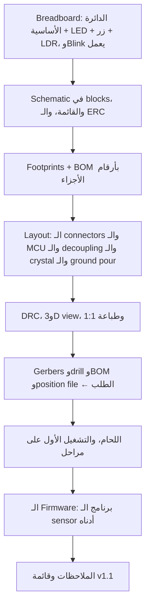

# مشروع: الـ sensor board الخاص بك

صمم، واطلب، وابنِ، وبرمج board ‏ATmega328P خاصًا بك من الصفر، متبعًا كل ما في هذا الكورس. وهذه هي المواصفات وخطة.

## المواصفات

| الميزة | المطلوب |
|---|---|
| الـ MCU | ‏ATmega328P، وcrystal ‏16 MHz، ومتوافق مع Arduino Uno |
| الكهرباء | ‏USB-C، وpolyfuse، وpower LED |
| البرمجة | ‏USB-serial ‏CH340C مع auto-reset **و**ISP header بـ 6 pins |
| المدخلات | ‏push button واحد (D2)، وdivider ‏LDR على A0 |
| المخرجات | ‏LED حالة واحد (D13)، وLED ‏PWM واحد (D9) |
| التوسعة | ‏header ‏I²C ‏(4 pins) مع pull-ups؛ والـ pins الاحتياطية على header ‏2.54 mm |
| الحجم | ‏50 × 40 mm على الأكثر، وطبقتان، و2 × ثقوب تثبيت M3 |
| الـ Silkscreen | أسماء الـ pins، واسم الـ board، والإصدار، والتاريخ، واسمك |

## الخطة



## الـ Firmware

عندما ينجح الـ board في التشغيل الأول، حمّل برنامجًا حقيقيًا: اقرأ مستوى الضوء، واعرضه كسطوع LED، وأرسل تقريرًا عبر الـ serial، وبدّل الأوضاع بالزر.

```cpp
const int BUTTON = 2, STATUS_LED = 13, PWM_LED = 9, LDR = A0;
bool nightMode = false;
bool lastButton = HIGH;
unsigned long lastChange = 0;

void setup() {
  pinMode(BUTTON, INPUT_PULLUP);
  pinMode(STATUS_LED, OUTPUT);
  pinMode(PWM_LED, OUTPUT);
  Serial.begin(9600);
  Serial.println("sensor board v1.0");
}

void loop() {
  // debounced button: toggle mode on each press
  bool now = digitalRead(BUTTON);
  if (now != lastButton && millis() - lastChange > 50) {
    lastChange = millis();
    if (now == LOW) nightMode = !nightMode;
    lastButton = now;
  }

  int light = analogRead(LDR);                       // 0 (dark) to 1023 (bright)
  int brightness = map(light, 0, 1023, 255, 0);      // darker room -> brighter LED
  if (!nightMode) brightness = 0;
  analogWrite(PWM_LED, brightness);
  digitalWrite(STATUS_LED, nightMode);

  static unsigned long lastPrint = 0;
  if (millis() - lastPrint > 1000) {
    lastPrint = millis();
    Serial.print("light=");
    Serial.print(light);
    Serial.print(" mode=");
    Serial.println(nightMode ? "night" : "off");
  }
}
```

لاحظ أنه لا يوجد `delay()`: الـ loop يعمل باستمرار ويستخدم `millis()` لتوقيت الأشياء، فيستجيب الزر فورًا دائمًا. وهذا هو الأسلوب الطبيعي لبرامج الـ microcontroller الحقيقية.

## للتوسع

اختر واحدًا أو أكثر:

1. أضف موديول sensor حرارة ورطوبة بـ I²C ‏(مثلًا breakout ‏SHT31 أو BME280) على الـ header ‏I²C، واطبع القراءات.
2. احفظ الوضع الذي اختاره المستخدم في **EEPROM** ليبقى بعد فصل الكهرباء.
3. ضع الـ board في وضع **sleep** بين القراءات وقِس كم ينخفض الـ current.
4. صمم v1.1: انتقل لأجزاء SMD ‏(ATmega بـ TQFP-32، وpassives ‏0603) واجعل المصنع يجمّعه.
5. أعد تصميم الـ board حول **RP2040** أو **ESP32**: نفس الـ blocks ‏(الكهرباء، والـ decoupling، والـ clock، والبرمجة، والـ I/O) مع chip مختلف.

## شاركه

انشر الـ KiCad project والـ Gerbers والـ BOM والـ firmware والصور في مستودع GitHub مع README يصف الـ pins وطريقة البرمجة. والـ board الذي يعمل وموثق وصممته بنفسك من أقوى الأشياء التي تستطيع عرضها في مقابلة وظيفة hardware أو embedded.

## الخلاصة

- المواصفات أولًا، ثم الـ breadboard، والـ schematic، والـ layout، والفحوص، والطلب، والتشغيل الأول، والـ firmware.
- استخدم توقيت `millis()` بدل `delay()` لتبقى المدخلات سريعة الاستجابة.
- توسّع بـ sensors ‏I²C والـ EEPROM والـ sleep؛ وشارك الـ project كاملًا بشكل مفتوح.

## فيديوهات اختيارية

الدرس أعلاه كامل وحده. هذه الفيديوهات للتعمق إن كنت تحب التعلم بالمشاهدة. الفيديوهات المكتوب بجانبها (بالإنجليزية) يمكنك تشغيل الترجمة لها (**CC**)، ثم **الإعدادات ← الترجمة ← ترجمة تلقائية ← العربية**.

**Standalone ATmega328P custom PCB: bootloader and upload (Tech at Home) (بالإنجليزية)**

https://www.youtube.com/watch?v=kmmQRWfTBkg
