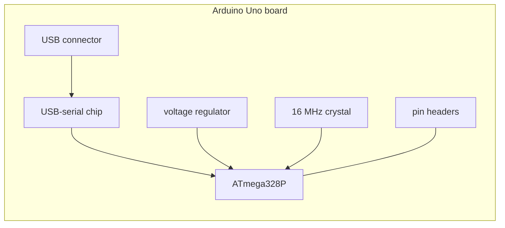

# What a microcontroller is

A **microcontroller** (MCU) is a small computer on one chip: a processor, memory for the program (flash), working memory (RAM) and many **pins** that can read buttons and sensors or switch LEDs and motors. It runs one program, forever, from the moment it gets power. Washing machines, keyboards, toys, car parts and thermostats all have them.

In this course you'll design your **own** microcontroller board around the **ATmega328P**, the chip on the Arduino Uno, then program it. You should know basic electronics and have designed a simple PCB in KiCad first (the two earlier courses in this path).

## Microcontroller vs Arduino board

An Arduino Uno is a ready-made board: the ATmega328P plus everything it needs (power, a clock, a way to load programs) and headers to plug wires into. Designing your own board means:

- it can be **smaller**, cheaper and shaped for your project
- you include **only what you need** (and add your sensors, buttons and connectors right on the board)
- you understand every part, which makes debugging much easier

## Inside the ATmega328P

| Feature | ATmega328P |
|---|---|
| Processor | 8-bit AVR, up to 20 MHz (16 MHz on Arduino) |
| Program memory (flash) | 32 KB |
| RAM | 2 KB |
| EEPROM (keeps data without power) | 1 KB |
| Digital I/O pins | 23 (on the 28-pin DIP version) |
| Analog inputs (10-bit ADC) | 6 |
| Communication | UART (serial), SPI, I²C |
| Supply voltage | 1.8 to 5.5 V (16 MHz needs about 4.5 V or more) |

Small numbers by today's standards, but plenty for reading sensors, controlling outputs and talking to a computer, and it uses very little power. The chip is cheap, well documented, sold in an easy-to-solder 28-pin DIP package, and works with the huge Arduino ecosystem.

## Other microcontrollers you'll meet

| Family | Why people pick it |
|---|---|
| **ATmega328P** (AVR) | simple, 5 V, breadboard friendly; great for learning |
| **RP2040 / RP2350** (Raspberry Pi) | fast, cheap, two cores, good USB |
| **ESP32** | Wi-Fi and Bluetooth built in; IoT projects |
| **STM32** (ARM Cortex-M) | the industry workhorse; huge range |

Everything you learn here (power, decoupling, clock, reset, programming header, layout) applies to all of them.

## Summary

- A microcontroller is a whole computer on one chip running one program from power-on.
- An Arduino Uno is an ATmega328P plus power, clock and programming parts; your own board can do the same, smaller.
- The ATmega328P: 8-bit, 16 MHz, 32 KB flash, 2 KB RAM, 23 I/O pins, UART/SPI/I²C.

## Optional videos

The lesson above is complete on its own. These videos go deeper, if you like learning by watching.

**How do CPUs read machine code? (Ben Eater)**

https://www.youtube.com/watch?v=yl8vPW5hydQ
