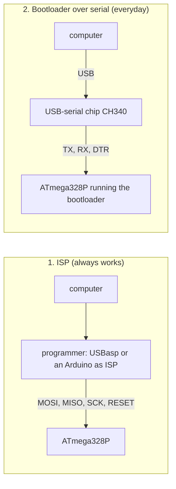

# Getting programs onto the chip

A new microcontroller is empty. There are two ways to load a program, and good boards support both.



## 1. ISP: in-system programming

The ATmega has a built-in programming interface on its SPI pins. A **programmer** (a cheap USBasp, or any Arduino running the "ArduinoISP" sketch) connects through a standard **6-pin ISP header**:

```text
ISP header (2x3, looking at the pins from above)
   MISO  1 ● ● 2  VCC
   SCK   3 ● ● 4  MOSI
   RESET 5 ● ● 6  GND
```

| Header pin | ATmega328P pin |
|---|---|
| 1 MISO | 18 (PB4) |
| 2 VCC | 7 |
| 3 SCK | 19 (PB5) |
| 4 MOSI | 17 (PB3) |
| 5 RESET | 1 |
| 6 GND | 8 |

ISP can do everything: write programs, burn a bootloader, and set the **fuses** (settings like "use the external crystal"). **Always put an ISP header on your board**: if anything else goes wrong, it's your way back in.

Note that PB5 is both SCK and the D13 LED. That's fine: the LED just blinks during programming.

## 2. The bootloader

A **bootloader** is a tiny program at the end of flash memory. After a reset, it listens on the serial pins for a moment: if a new program arrives, it writes it to flash; if not, it starts your program. That's how an Arduino gets programmed over USB with no programmer.

You put the bootloader on once, with ISP ("Burn Bootloader" in the Arduino IDE). Chips sold "with Arduino bootloader" already have it.

## The USB-serial chip

The ATmega328P has no USB. A **USB-to-serial** chip translates:

| Chip | Notes |
|---|---|
| **CH340** (CH340C / CH340G) | cheap and common; the "C" version needs no crystal |
| **CP2102** | reliable drivers everywhere |
| **FT232R** | the classic, more expensive |

Connections (with the CH340C):

| CH340C | ATmega328P | Note |
|---|---|---|
| TXD | 2 (RXD) | TX goes to RX |
| RXD | 3 (TXD) | RX goes to TX |
| DTR (or RTS) | 1 (RESET) **through 100 nF** | resets the chip when uploading starts |
| D+ / D− | USB connector D+ / D− | |
| VCC, GND | 5 V, GND | plus 100 nF decoupling |

The **100 nF from DTR to RESET** gives auto-reset: when the computer opens the port, DTR goes low, the capacitor sends a short low pulse to RESET, the chip restarts, and the bootloader catches the upload. Without it you'd have to press reset at exactly the right moment.

A simpler option: leave the USB-serial chip off the board and add a **6-pin "FTDI" header** (GND, CTS, VCC, TX, RX, DTR) to plug in a ready-made USB-serial adapter cable. Smaller board, one fewer chip to solder.

## Fuses

Fuses are settings stored in the chip (not physical fuses). The important ones:

- **clock source**: external crystal vs internal 8 MHz
- **divide clock by 8**: new chips come set to the internal 8 MHz ÷ 8 = 1 MHz!
- **bootloader size** and whether to jump to it after reset

Burning the bootloader from the Arduino IDE also sets the right fuses for an Uno-style board. Wrong clock fuses (for example "external crystal" on a board without one) make the chip look dead until you give it a clock, so double-check before writing fuses manually.

## Summary

- ISP (6-pin header to MOSI, MISO, SCK, RESET, VCC, GND) always works; put it on every board.
- A bootloader lets you upload over serial; a USB-serial chip (CH340) or an FTDI header connects it to a computer.
- Cross TX/RX, and add 100 nF from DTR to RESET for auto-reset; fuses set the clock source.

## Optional videos

The lesson above is complete on its own. These videos go deeper, if you like learning by watching.

**Burn the bootloader and upload to an ATmega328P on a breadboard, Arduino as ISP (DIY Hideout)**

https://www.youtube.com/watch?v=smr9EddIL3Q
