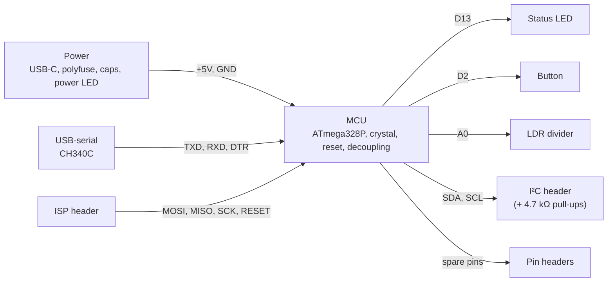

# The full board schematic

Now combine everything into one board in KiCad. The example board for this module: a small **sensor board** with:

- USB-C power and programming (CH340C)
- ATmega328P with crystal, reset and ISP header
- a status LED, a button, and a light sensor (LDR) on A0
- an I²C header for a temperature sensor module
- headers that bring out the spare pins

## Organize the schematic in blocks

Big schematics are easier to read and check when split into functional blocks. Draw each block in its own area of the sheet (or on separate sheets with KiCad's **hierarchical sheets**), joined by **net labels**:



Use clear net names: `+5V`, `GND`, `USB_DP`, `USB_DN`, `MCU_RX`, `MCU_TX`, `DTR`, `RESET`, `SDA`, `SCL`. Name signals from the microcontroller's point of view, and the TX/RX crossover is easy to check.

## The blocks

**Power**: the USB-C circuit from module 2 (VBUS, polyfuse, 10 µF, 100 nF, power LED, 5.1 kΩ on CC1 and CC2). Add a PWR_FLAG on +5V and GND.

**USB-serial**: CH340C with its 100 nF decoupling; D+ and D− to the USB connector; TXD to `MCU_RX`, RXD to `MCU_TX`; DTR through 100 nF to `RESET`. Check the CH340C datasheet's pin numbers and its V3 pin (connected to VCC with a 100 nF capacitor when running at 5 V).

**MCU**: the minimal circuit from module 2: VCC and AVCC to +5V with 100 nF each, both GNDs, AREF with 100 nF to ground, 16 MHz crystal with 2 × 22 pF, 10 kΩ RESET pull-up, reset button.

**ISP header**: the 2×3 header wired to MISO, SCK, MOSI, RESET, +5V, GND.

**I/O**: LED + 330 Ω on D13; button on D2 to ground (internal pull-up in code; add a footprint for an external 10 kΩ anyway, you can leave it unpopulated); LDR + 10 kΩ divider on A0; I²C header (VCC, GND, SDA, SCL) with **4.7 kΩ pull-ups** on SDA and SCL.

## Checking the schematic

Before layout, check carefully. A mistake found now costs nothing; on a manufactured board it costs a new order.

```python
checks = [
    "VCC, AVCC to +5V; GND pins 8 and 22 to GND",
    "100 nF on VCC, AVCC, AREF and the CH340C",
    "crystal on pins 9 and 10 with two 22 pF to GND",
    "RESET: 10 kΩ pull-up, button to GND, 100 nF from DTR",
    "TX of each chip goes to RX of the other",
    "ISP header pin order matches the standard 2x3 layout",
    "USB-C: 5.1 kΩ on CC1 and CC2, D+ and D- not swapped",
    "I2C pull-ups present (and only once on the bus)",
    "PWR_FLAGs placed, ERC clean",
]
for i, c in enumerate(checks, 1):
    print(f"[ ] {i}. {c}")
```

```output
[ ] 1. VCC, AVCC to +5V; GND pins 8 and 22 to GND
[ ] 2. 100 nF on VCC, AVCC, AREF and the CH340C
[ ] 3. crystal on pins 9 and 10 with two 22 pF to GND
[ ] 4. RESET: 10 kΩ pull-up, button to GND, 100 nF from DTR
[ ] 5. TX of each chip goes to RX of the other
[ ] 6. ISP header pin order matches the standard 2x3 layout
[ ] 7. USB-C: 5.1 kΩ on CC1 and CC2, D+ and D- not swapped
[ ] 8. I2C pull-ups present (and only once on the bus)
[ ] 9. PWR_FLAGs placed, ERC clean
```

Print it, and tick each item while tracing the schematic with a highlighter. It's also a good idea to compare your design with the open-source Arduino Uno schematic, which shows the same blocks.

## Footprints for a microcontroller board

| Part | Easy to hand-solder | Smaller (factory assembly) |
|---|---|---|
| ATmega328P | DIP-28 (in a socket) | TQFP-32 (0.8 mm pitch) |
| CH340C | SOIC-16 | SOIC-16 |
| Crystal | HC-49 through-hole | 3225 SMD |
| Passives | 0805 | 0603 |
| USB-C | through-hole "power only" | SMD 16-pin |

A DIP-28 in a socket is a great choice for a first board: if the chip is damaged, you swap it.

## Summary

- Draw the board as blocks (power, USB-serial, MCU, ISP, I/O) joined by clear net labels.
- Use the minimal circuit, the USB-C power circuit and the auto-reset trick from earlier lessons.
- Check against a printed list before layout; choose footprints you can solder (DIP-28 in a socket is friendly).

## Optional videos

The lesson above is complete on its own. These videos go deeper, if you like learning by watching.

**KiCad STM32 PCB design, full tutorial (Phil's Lab)**

https://www.youtube.com/watch?v=aVUqaB0IMh4
